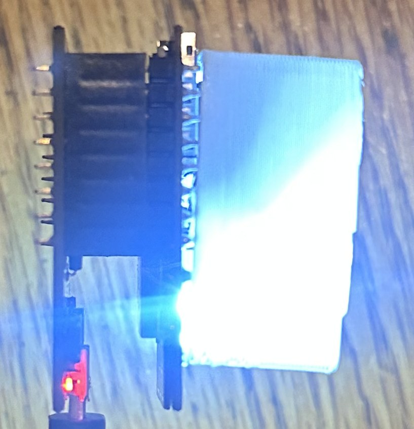
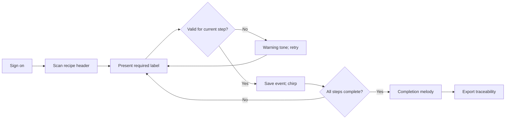
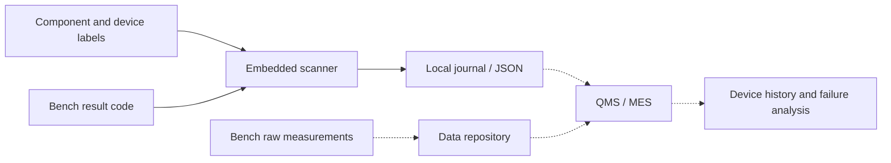
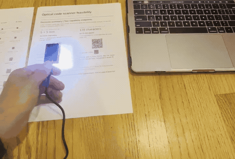
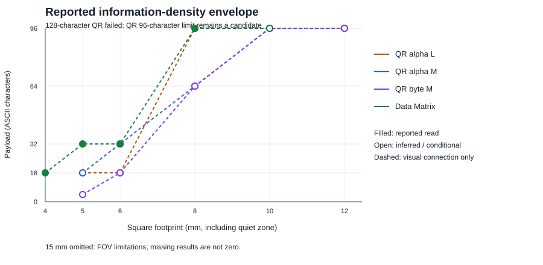

# Manufacturing & Test Traceability Scanner

Embedded, document-driven verification for prototype assembly, manufacturing and testing.

## The problem

Quality management depends on knowing where a device came from, which components and lots were used, what tests it completed, and where its results can be found.

Two recurring challenges with handwritten  and manual computer entries or manufacturing or functional tests are:

| **Time spent recording information** | **Human error from manual entry** |
| --- | --- |
| Operators repeatedly copy serial numbers, lot numbers, equipment IDs and results which costs time instead of focusing this effort on assembling or testing the device. | Mistyped identifiers, missing records, duplicate entries and incorrect device-to-test associations undermine traceability. |

## The solution

Scan existing instructions, component labels and instrument results instead of transcribing them. The scanner checks the expected workflow, provides immediate audible and visual feedback, and stores structured records. After sign-on, Embedded mode does not require a connected computer for each scan.

| Handwritten records | Manual computer entry | Scan-driven verification |
| --- | --- | --- |
| Copy identifiers onto a traveler | Type identifiers into a digital form | Present a label to the scanner |
| Manual review of sequence and duplicates | Depends on application validation | Built-in recipe and duplicate checks |
| Physical records need digitization | Digital records | Timestamped local journal and JSON export |

For a six-component assembly traveler (device identification, six part/lot/serial records and final confirmation), a rough planning estimate is:

| Documentation activity | Handwritten | Manual computer entry | Embedded scanning |
| --- | ---: | ---: | ---: |
| Record and check identifiers | 3–5 min | 2–4 min | 30–60 s |
| Investigate a missing or incorrect identifier (per incident) | 5–15 min | 2–10 min | 1–5 min if detected at scan; longer for incorrect source labels |

These are illustrative engineering estimates, not measured comparisons. Physical assembly, initial sign-on and label creation are excluded. Investigation time depends on record availability and labeling quality; an incorrect source label can still compromise scan-based traceability. The 47-second recorded demonstration provides a qualitative scanning reference.

The intended benefits are less documentation overhead and fewer manual-entry errors. Comparative time savings and error rates have not yet been measured.

<p align="center">


</p>

The prototype combines an ESP32-CAM, OV5640 camera, controlled white illumination, passive buzzer, Wi-Fi and local flash storage. Labels can be printed on travelers, PCBs, components, packaging and fixtures, or displayed on a computer or electronic-paper screen.

## Operator experience

### 1. Operator sign-on


Enter the operator, department and test context from a computer or mobile browser.

### 2. Start the procedure

Scan the four-digit Code 128 header from the [shared instruction sheet](docs/workflows/instructions.pdf). The station selects the recipe and displays the required steps.

### 3. Verify components

Present each required label. The station captures part numbers, lots, serials and timestamps; accepted components are marked verified. Embedded mode requires no browser interaction between scans.

### 4. Correct errors

A repeated component, unexpected label or wrong step triggers a warning. The verified component count remains unchanged until the correct label is accepted.

### 5. Complete and export

Rescan the original device after all requirements are satisfied. The dashboard shows the completed procedure and the operator can export the journal. See the [assembly demonstration](docs/workflows/01-component-assembly/README.md) for the recorded example.




[Operating instructions](docs/OPERATIONS.md) · [Audible settings and electrical details](docs/HARDWARE_AND_FIRMWARE.md)

## Manufacturing and test examples

[**Open the four-workflow instruction PDF**](docs/workflows/instructions.pdf) — print at 100% scale or display digitally.

| Application | Purpose |
| --- | --- |
| [01 — Component assembly](docs/workflows/01-component-assembly/README.md) | Capture device genealogy; prevent duplicate and missing components |
| [02 — Benchtop functional test](docs/workflows/02-benchtop-functional-test/README.md) | Associate device, bench, PASS/FAIL result and measurement reference |
| [03 — Thermal fixture test](docs/workflows/03-thermal-fixture-test/README.md) | Verify fixture, accessories and temperature result |
| [04 — Environmental aging](docs/workflows/04-environmental-aging/README.md) | Record chamber exposure and confirm removal |

### Assembly demonstration

[](docs/media/assembly-audible.mp4)

[Watch the full 47-second demonstration with sound](docs/media/assembly-audible.mp4). The example uses printed labels to demonstrate standalone scanning. The firmware rejects wrong recipes, unexpected parts, duplicate components and premature closure. A visual inspection is an operator instruction, not a firmware-verified action.

[All workflow details and acceptance criteria](docs/workflows/README.md)

## From device history to failure investigation

A device serial connects component genealogy and test history. The scanner records the equipment identifier, measurement disposition and data reference, alongside operator and time information. In a production integration, the bench would upload raw measurements to a data repository and display a result code with the matching reference. The QMS or MES could join both records to investigate recurring failures by component lot, equipment or hardware revision.



Solid paths represent prototype capabilities; dotted paths represent proposed external integration. The scanner does not currently operate instruments, retrieve raw signals or connect to a live QMS.

[Integration architecture, data examples and remaining requirements](docs/integration/README.md)

## Optical characterization

Compact markings enable traceability on space-constrained PCBs. Our initial bench observations target QR footprints of 5–15 mm and Data Matrix down to 4 mm.

| Compact marking | QR density | Size ladder |
| :---: | :---: | :---: |
|  |  |  |

| Format | Footprint | Payload / observation |
| --- | --- | --- |
| Data Matrix | 4 × 4 mm | 16 ASCII characters reported read |
| Data Matrix | 8 × 8 mm | 96 characters reported read |
| QR | 5 × 5 mm | 16 characters reported read |
| QR | 10–12 mm | 96-character candidate; 128-character attempt failed |
| QR-M | 15 × 15 mm | PCB-002 (7 characters) reported read; maximum payload unknown |



A 5 mm QR V1/M size-ladder code was also successfully recognized (4-character P:05). Its nominal 172 µm module pitch corresponds to about four dots per module at 600 DPI, an engineering target rather than a measured printer specification. For production exploration, start with 600 DPI or better, short Data Matrix identifiers on compact PCBs and larger QR labels for richer records. Print resolution is a practical constraint, but higher DPI alone does not guarantee recognition. Print quality, optics, focus and field of view have not been isolated experimentally. These are qualitative bench observations, not guaranteed operating limits.

[Characterization, original test sheets and evidence](docs/characterization/README.md)

## Browser vs. Embedded

| | Browser | Embedded |
| --- | --- | --- |
| Recognition | ZXing WASM in connected browser | ZXing C++ on ESP32 |
| Images | Live JPEG preview | Last decoded still |
| Connected browser during scanning | Required | Not required after sign-on |
| Formats | QR, Data Matrix, Code 128, Code 39 | QR, Data Matrix; Code 128 while idle |
| Workflow validation and journal | On device | On device |

Both modes decode the full selected frame, from QVGA up to UXGA (1600 × 1200); VGA is the default. The prototype has a 192 KiB local archive, 50 recent native records in RAM and password-protected dual-slot OTA.

[Hardware and firmware architecture](docs/HARDWARE_AND_FIRMWARE.md) · [PCB inspection example](docs/inspection/README.md)

## Getting started

Build with PlatformIO, install through USB, configure Wi-Fi through the setup AP, and open the device address in a browser.

```sh
pio run
pio run -t upload --upload-port PORT
```

USB upload: 460800 baud. Serial monitor: 115200 baud. Sign on, select Embedded, resume scanning and use the shared instruction PDF.

[Detailed operation and OTA](docs/OPERATIONS.md) · [Verification plan](docs/VERIFICATION_PLAN.md)

## Limits and next steps

This is an engineering prototype, not a qualified manufacturing or regulated QMS system. It checks labels, sequence and reported outcomes, not physical installation or instrument accuracy. Active runs are lost on reboot; archive capacity is finite, sign-on is self-reported, and thermal performance requires validation. Use a trusted local network.

Next: timed comparisons of manual and scanned workflows, controlled optical and reliability tests, durable run recovery, actual instrument integration and authenticated QMS connectivity.

[Comparative validation protocol](docs/validation/README.md) · [Changelog](CHANGELOG.md) · [Third-party notices](docs/THIRD_PARTY.md)
