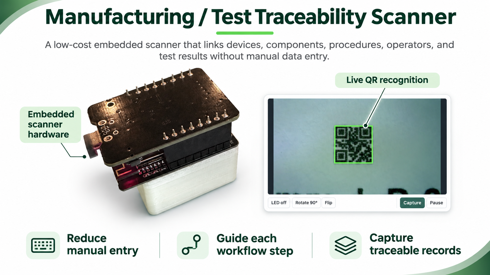
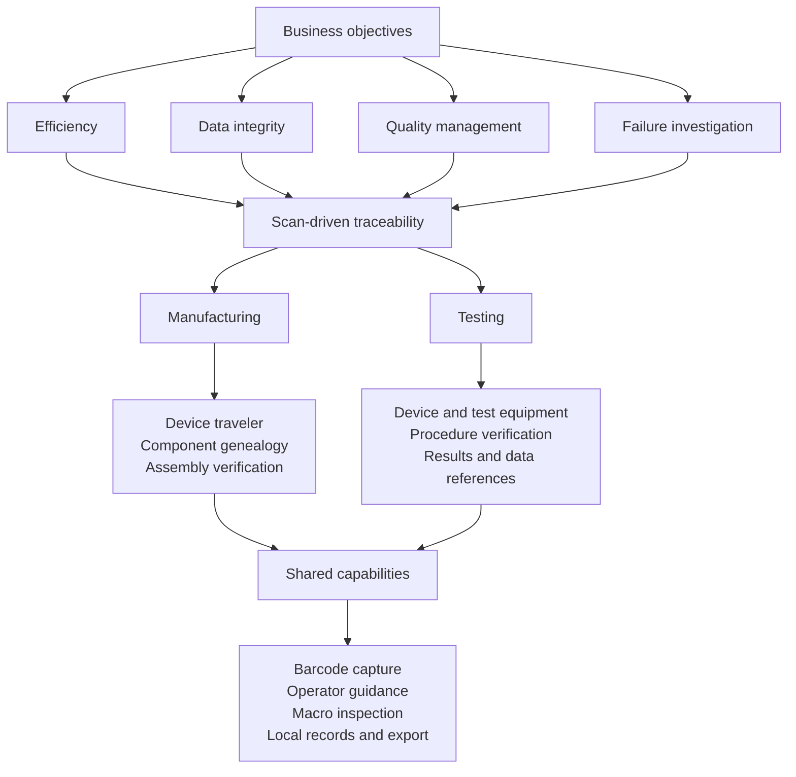
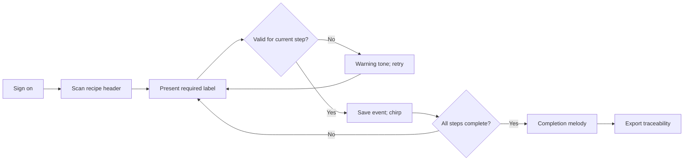
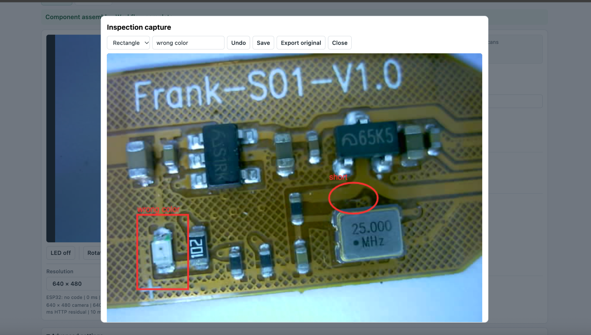

Reduce manual data entry, guide manufacturing and test workflows, and capture traceable records.

## Contents

- [The Problem](#the-problem)
  - [Estimated documentation time and potential savings](#estimated-documentation-time-and-potential-savings)
- [The Solution](#the-solution)
- [How it works](#how-it-works)
- [Manufacturing and test examples](#manufacturing-and-test-examples)
- [Macro inspection and defect documentation](#macro-inspection-and-defect-documentation)
- [Results and conclusion](#results-and-conclusion)
- [Future development](#future-development)
- [Technical documentation](#technical-documentation)
- [License](#license)

## The Problem

For every device, teams need to connect its identity, component lots, test setup, and result. Manual recording creates two common problems:

| **Time spent recording information** | **Errors in manual records** |
| --- | --- |
|  |  |
| Operators copy serial numbers, lots, equipment IDs, and results instead of assembling or testing devices. | Mistyped identifiers, missing records, and duplicate entries can break the link between a device and its test. |

### Estimated documentation time and potential savings

For a six-component assembly traveler, compare manual documentation with our system’s scan-driven approach:

| Documentation activity | Handwritten | Manual computer entry | **Our system (estimated)** |
| --- | ---: | ---: | ---: |
| Record and check identifiers | 3–5 min | 2–4 min | **10–60 s** |
| Investigate a missing or incorrect identifier (per incident) | 10–60 min | 1–30 min | **0 min** |

#### Estimated documentation effort — 100 devices

| Activity | Handwritten | Manual computer entry | **Our system (estimated)** |
| --- | ---: | ---: | ---: |
| Record and check identifiers (100 devices) | 5–8 hr 20 min | 3 hr 20 min–6 hr 40 min | **17 min–1 hr 40 min** |
| Investigate 10 manual-entry incidents | 1 hr 40 min–10 hr | 10 min–5 hr | **0 min* ** |
| **Combined estimated time** | **6 hr 40 min–18 hr 20 min** | **3 hr 30 min–11 hr 40 min** | **17 min–1 hr 40 min** |

Engineering estimates assume 10 manual-entry incidents per 100 devices. *Zero minutes: based on elimination of bad data enteries. See the [comparative validation protocol](docs/validation/README.md).

## The Solution

A low-cost, scan-driven traceability system designed to improve manufacturing and testing by reducing manual data entry, verifying required scan steps and capturing structured records.

The prototype combines an ESP32 and a OV5640 camera, controlled white illumination, passive buzzer, Wi-Fi, and local flash storage. The low-cost camera and lens were modified for close-range, macro-level imaging, enabling compact barcode recognition and detailed PCB inspection with the same hardware. Labels can be printed on travelers, PCBs, components, packaging, and fixtures, or displayed on a computer or electronic-paper screen.

## How it works

## Manufacturing and test examples

[**Printable work instructions for experimental testing (PDF)**](docs/workflows/instructions.pdf) — print at 100% scale or display digitally.

| Application | Purpose |
| --- | --- |
| [01 — Component assembly](docs/workflows/01-component-assembly/README.md) | Capture device genealogy; prevent duplicate and missing components and record component information |
| [02 — Benchtop functional test](docs/workflows/02-benchtop-functional-test/README.md) | Associate device, operator, timing, bench, PASS/FAIL result and measurement reference |
| [03 — Thermal fixture test](docs/workflows/03-thermal-fixture-test/README.md) | Verify fixture, operator timing, accessories and temperature result |
| [04 — Environmental aging](docs/workflows/04-environmental-aging/README.md) | Record chamber exposure time, operator, and confirm removal |

### Assembly demonstration

| Assembly demonstration with 6 components |
| :---: |
|  |

[Watch the full 47-second demonstration with sound](docs/media/assembly-audible.mp4). The recorded example uses printed labels and the scanner’s embedded workflow. The firmware rejects wrong recipes, unexpected parts, duplicate components, and premature closure. The workflow also guides the operator through visual inspection.

## Macro inspection and defect documentation

The modified close-focus camera also captures macro-level PCB images for manual inspection and annotation. Preserve the original image and export the marked copy for test review.

[Inspection procedure and examples](docs/inspection/README.md) · [Scanner settings, Wi-Fi and OTA guide](docs/settings/README.md)

Export original and annotated images from the browser and associate them with the relevant device or test record.

## Results and conclusion

The macro-modified scanner demonstrated compact printed barcode recognition, guided assembly and test workflows, and structured traceability records.

| Format | Printed footprint | Payload | Bench result |
| --- | ---: | ---: | --- |
| QR | 5 × 5 mm | 4–16 characters | Smallest successful QR footprint |
| QR | 8 × 8 mm | Up to 96 characters | Alphanumeric capacity inferred from the tested version cutoff |
| QR | 10–12 mm | 96 characters | Candidate marking size for denser records |
| Data Matrix | 4 × 4 mm | 16 characters | Smallest successful marking |
| Data Matrix | 5–6 mm square | 32 characters | Reported read |
| Data Matrix | 8 × 8 mm | 96 characters | Reported read |

**Practical limits:** A 5 mm Version 1 QR code has a nominal module pitch of 172 µm, or approximately 4 printer dots per module at 600 DPI. Start with 600 DPI and evaluate 1200 DPI for smaller or denser markings. The current laser printer shows irregular module edges; its actual DPI is unverified. Print fidelity, focus, lighting and field of view jointly determine recognition. The 128-character QR attempt failed; the maximum repeatable payload remains to be established.

For compact PCBs, use short Data Matrix identifiers linked to a richer device record. Larger QR labels can carry component details, test outcomes and measurement references directly.

[Full characterization, print-resolution calculations and scanning demonstrations](docs/characterization/README.md)

## Future development

| Development area | Objective |
| --- | --- |
| Backend and QMS integration | Centralize device genealogy, test results, inspection images and measurement references across stations. |
| Edge AI and segmentation | Localize components and inspect regions of interest using on-device inference. |
| Anomaly detection | Flag potential assembly, soldering and visual defects for operator review. |
| OCR | Capture printed markings, instrument displays and handwritten documentation. |
| Automatic note transcription | Convert spoken operator observations into reviewable, timestamped test notes. |

The next phase extends the scanner from structured code capture to assisted inspection and connected manufacturing records, with validation of recognition reliability and AI performance before deployment.

## Technical documentation

| Documentation | Contents |
| --- | --- |
| [Operator experience](docs/operator/README.md) | Sign-on, step-by-step screenshots, error handling and completion |
| [Manufacturing and test workflows](docs/workflows/README.md) | Four procedures, acceptance criteria and example records |
| [What the scanner records](docs/barcodes/README.md) | Supported symbols, structured payloads and scan screenshots |
| [Macro inspection](docs/inspection/README.md) | Capture, annotate and export inspection images |
| [Scanner settings and audible feedback](docs/settings/README.md) | Camera, lighting, buzzer, Wi-Fi and OTA settings |
| [Hardware and firmware](docs/HARDWARE_AND_FIRMWARE.md) | ESP32, camera, decoding modes, storage and security |
| [Optical characterization](docs/characterization/README.md) | Barcode sizes, payload capacity, printing and experimental evidence |
| [Traceability and QMS integration](docs/integration/README.md) | Record structure, proposed integration and failure investigation |
| [Getting started and operation](docs/OPERATIONS.md) | Build, flash, configure and operate the scanner |
| [Validation and test evidence](docs/validation/README.md) | Comparative timing protocol, reliability and verification |

[Documentation index](docs/README.md) · [Detailed test report](docs/TEST_REPORT.md) · [Verification plan](docs/VERIFICATION_PLAN.md) · [Changelog](CHANGELOG.md)

## License

Original software is **source-available for noncommercial use**, including
personal projects and noncommercial academic teaching and research.
Modification and noncommercial redistribution are permitted with attribution
and preservation of the license terms. Corporate evaluation requires written
permission; internal commercial use and commercial deployment require a
separate license.

[Project license](LICENSE) · [Commercial licensing inquiries](COMMERCIAL_LICENSE.md) · [Third-party notices](docs/THIRD_PARTY.md)
