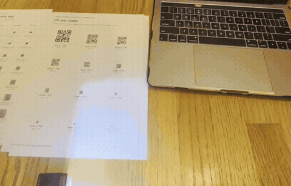

# Manufacturing QR & Data Matrix Scanner

ESP32-CAM and OV5640 scanner for component identification, lot traceability and PCB inspection. Supports browser and native ESP32 decoding over a local network.

| Information density | Compact markings | QR size ladder |
| :---: | :---: | :---: |
|  |  |  |
| [MP4](docs/media/demo-density-scanning.mp4) | [MP4](docs/media/demo-compact-marking.mp4) | [MP4](docs/media/demo-qr-ladder.mp4) |

## Features

- QR, Data Matrix and linear barcode recognition in the browser.
- Experimental standalone QR and Data Matrix decoding using native ZXing-C++.
- Side-by-side decoder testing, scan history and CSV export.
- Adjustable color JPEG resolution, scan rate, CPU frequency, Wi-Fi power saving and LED PWM.

## Manufacturing workflow

Scan a part, serial or lot number; associate it with the manufacturing record; capture close-up PCB photographs; circle defects and add notes for inspection, rework and nonconformance reports.

Barcode scanning and live imaging are implemented. Persistent MES records, calibrated macro optics, still-image capture and non-destructive annotation are planned.

## PCB inspection

Operator-reported capacitor short; electrical verification required. [Original image](docs/inspection/pcb-original.png).

## Bench results

| Marking | Footprint | Payload |
|---|---:|---:|
| Smallest reported QR | 5 × 5 mm | 16 characters |
| Smallest reported Data Matrix | 4 × 4 mm | 16 characters |
| Data Matrix density | 8 × 8 mm | 96 characters |
| QR density candidate | 8–12 mm | 96 characters; retest required |

The 128-character QR failed. Dimensions include quiet zones. Results are from printed targets, not production reliability tests.

## Hardware

| Component | Specification |
|---|---|
| MCU | ESP32, 4 MB flash, 4 MB PSRAM detected |
| Camera | OV5640, color JPEG up to 1600 × 1200 |
| Illumination | GPIO4, 20 kHz PWM |
| Browser decoder | ZXing-WASM 3.1.7 |
| Native decoder | ZXing-C++ 2.2.1 |

## Decoder modes

| Mode | Processing |
|---|---|
| Browser | ZXing-WASM on PC or phone |
| Standalone | Native QR/Data Matrix on ESP32 |
| Compare | Both engines using the same JPEG |

Native recognition uses a central crop up to 640 × 480 pixels. Native scan history holds 50 entries in RAM; browser history is session-only. Native physical read limits remain unverified.

## Setup

1. Install PlatformIO Core and connect the USB serial programmer.
2. Build with `pio run`.
3. Identify the USB port with `pio device list`, then run `pio run -t upload --upload-port <port>`.
4. Open the serial monitor at 115200 baud. For initial setup, join the scanner AP using the password printed in the monitor and configure Wi-Fi at 192.168.4.1.
5. Open the assigned scanner IP in a browser and select the decoder mode.

Prototype runs hot during continuous capture. Stop if excessively hot; use only on a trusted local network.

## Documentation

- [Hardware and firmware](docs/HARDWARE_AND_FIRMWARE.md)
- [Test report](docs/TEST_REPORT.md) · [Per-target results](docs/MARKED_RESULTS.md) · [Observations CSV](test/observations.csv)
- Test sheets: [Mixed barcodes](docs/test-sheets/manufacturing_barcode_test.pdf) · [QR density](docs/test-sheets/QR_information_density_test.pdf) · [Data Matrix / PCB](docs/test-sheets/PCB_Data_Matrix_and_QR_Test.pdf)
- [Verification plan](docs/VERIFICATION_PLAN.md) · [Trial template](test/trial_template.csv) · [Validation CSV](test/validation_template.csv)
- [Changelog](CHANGELOG.md)
- [Third-party licenses](docs/THIRD_PARTY.md) · [Superseded report](docs/archive/Scanner_System_Validation_SUPERSEDED.pdf)

## Next steps

- Validate native recognition, minimum marking size and ±5% dimensional tolerance.
- Measure power, temperature and scan latency; implement sensor standby.
- Add physical trigger, photo capture, annotation and persistent lot records.
- Qualify actual PCB markings and review security/licensing before release.
