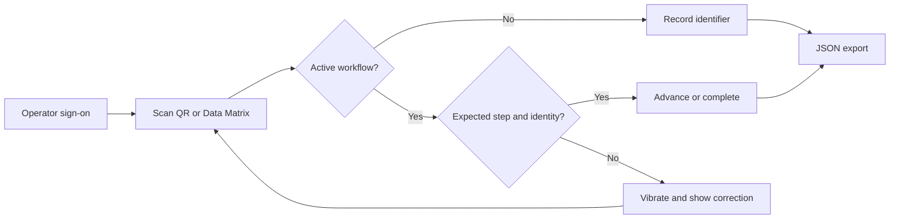
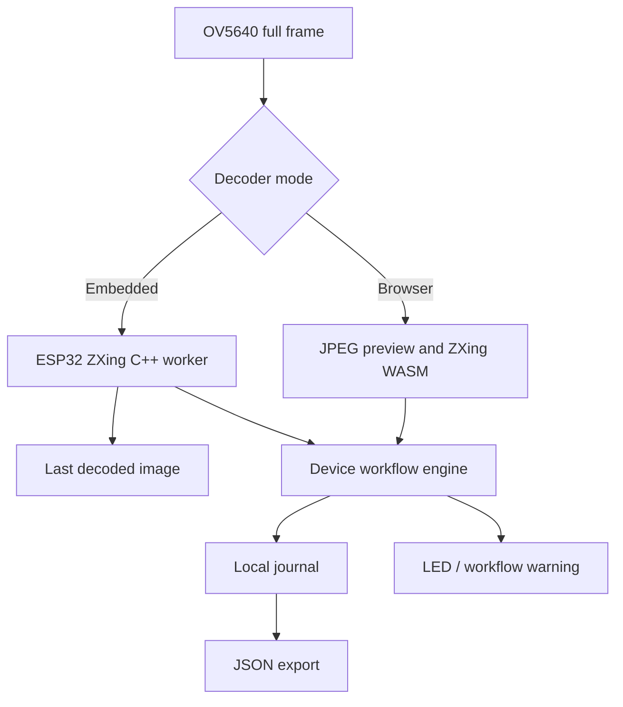

# Manufacturing Test Scanner

A compact ESP32-CAM station for identifying components, verifying assembly and test sequences, and recording traceability data without manual transcription.

<p align="center">


</p>

## Operator workflow

| Sign on | Scan and identify |
| :---: | :---: |
|  |  |

Enter operator, department and test; scan labels in the Scanner tab or select a defined recipe in Workflows. Successful scans flash the white LED. Workflow errors trigger vibration and the red status LED. Inspect records and export JSON.



## Manufacturing and test pipelines

| Recipe | Verification |
|---|---|
| Assembly | Six required unique components; confirm original device |
| Functional test | Device, bench, result reference; confirm within 60 seconds |
| Thermal setup | Fixture, device, bag, supply, probe, result and confirmation |
| Aging | Chamber, loading, opening and removal; 24-hour example dwell |

[Four workflow diagrams and instructions](docs/workflows/README.md) · [Printable mixed-format pipeline tests (PDF)](docs/test-sheets/manufacturing-pipeline.pdf)

## Optical feasibility

| Compact markings | QR density | Size ladder |
| :---: | :---: | :---: |
|  |  |  |

| Marking | Reported bench read |
|---|---|
| QR | 5 × 5 mm, 16 characters |
| Data Matrix | 4 × 4 mm, 16 characters |
| Data Matrix | 8 × 8 mm, 96 characters |
| QR | 10–12 mm, 96 characters remains a candidate; 128-character attempt failed |


These observations include quiet zones and are not qualified operating limits. Repeatability, working distance, print quality, lighting and maximum reliable payload remain uncharacterized. See [test report](docs/TEST_REPORT.md), [per-target evidence](docs/MARKED_RESULTS.md) and [verification plan](docs/VERIFICATION_PLAN.md).

## Architecture




- Both decoders: QR and Data Matrix; VGA default, up to 1600 × 1200. No intentional center crop.
- Browser: live preview. Embedded: standalone recognition and last decoded still image.
- 192 KiB flash journal; 50 recent native records in RAM; browser-local rules and annotated images.
- GPIO4 illumination, GPIO33 status LED, GPIO13 motor driver. Password-protected dual-slot OTA.

[Hardware and firmware](docs/HARDWARE_AND_FIRMWARE.md) · [Operating instructions](docs/OPERATIONS.md) · [PCB inspection example](docs/inspection/README.md)

## Build

```sh
pio run
pio run -t upload --upload-port PORT
```

Configure Wi-Fi using the device setup AP if needed, then open the scanner address. USB upload: 460800 baud; serial monitor: 115200 baud.

## Repository

| Path | Contents |
|---|---|
| `src/` | ESP32 firmware, camera, workflow engine and HTTP API |
| `web/` | Dashboard, sign-on, parsing and recipe presentation |
| `test/` | Regression tests and optical observations |
| `docs/workflows/` | Process diagrams and printable label examples |
| `docs/test-sheets/` | Optical and pipeline test PDFs |
| `docs/media/` | Prototype photographs and demonstrations |

## Limits and next steps

Engineering prototype, not production-qualified. Workflow verification checks scanned identifiers, not physical assembly, instrument readings or test execution. Active runs are lost on reboot; the aging example tracks one device per run. Operator sign-on is self-reported; use trusted LAN only. Continuous operation has caused heating. Linear barcodes on the pipeline sheet are capability targets, not enabled formats.

Next: fixture API, measurement association, durable run recovery, external storage and timed operator studies. No measured productivity improvement is claimed.

[Changelog](CHANGELOG.md) · [Third-party notices](docs/THIRD_PARTY.md)
