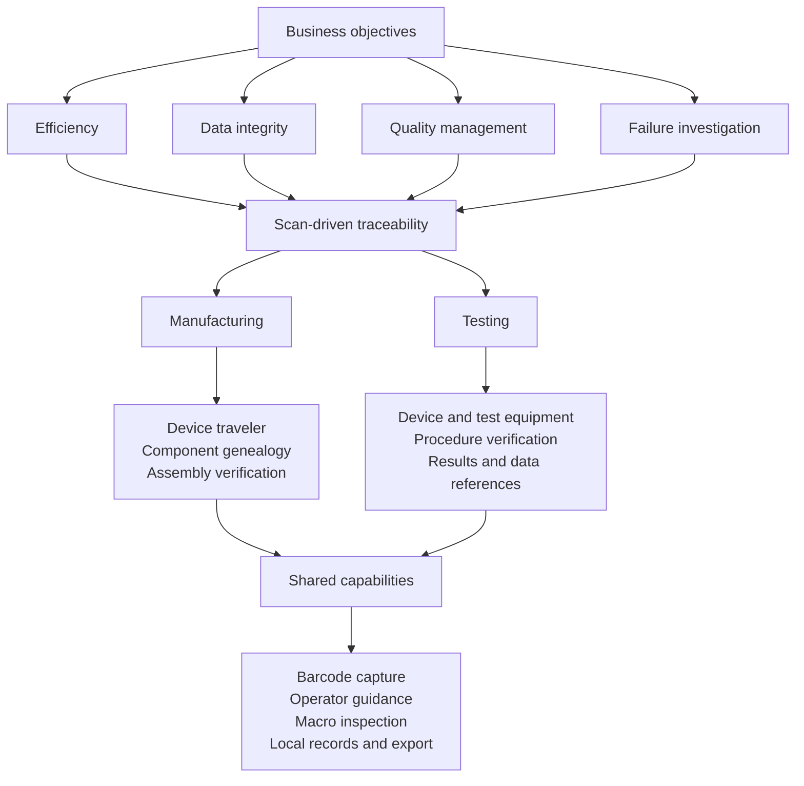
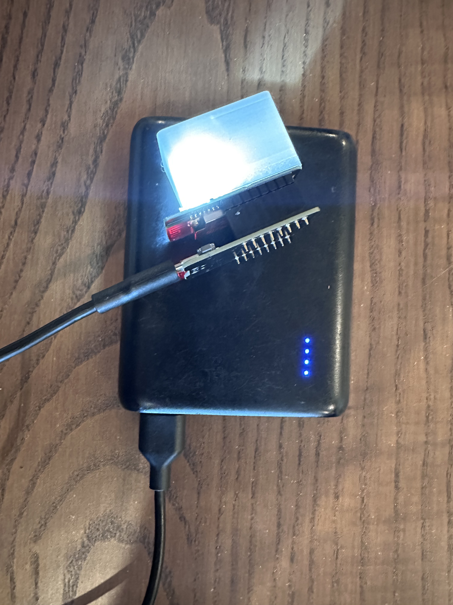
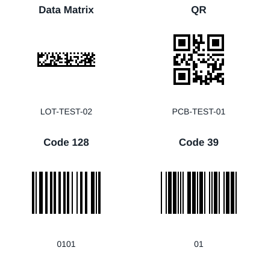
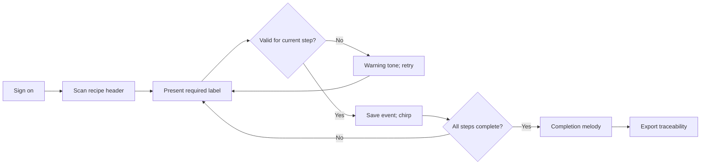
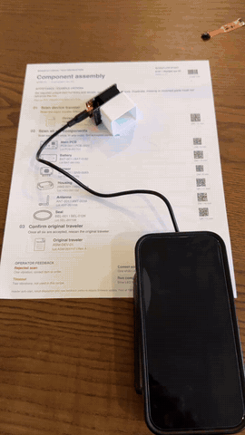

# Manufacturing & Test Traceability Scanner

An ESP32 and camera-based scan-to-record prototype for manufacturing and test workflows that reduces manual data entry, guides operators, and captures traceable records.

## Contents

- [The Problem](#the-problem)
  - [Estimated documentation time and potential savings](#estimated-documentation-time-and-potential-savings)
- [The Solution](#the-solution)
- [How it works](#how-it-works)
- [Manufacturing and test examples](#manufacturing-and-test-examples)
- [Macro inspection and defect documentation](#macro-inspection-and-defect-documentation)
- [Results and conclusion](#results-and-conclusion)
- [Future development](#future-development)
- [Technical documentation](#technical-documentation)
- [License](#license)

## The Problem

For every device, teams need to connect its identity, component lots, test setup, and result. Manual recording creates two common problems:

| **Time spent recording information** | **Errors in manual records** |
| --- | --- |
|  |  |
| Operators copy serial numbers, lots, equipment IDs, and results instead of assembling or testing devices. | Mistyped identifiers, missing records, and duplicate entries can break the link between a device and its test. |

### Estimated documentation time and potential savings

Manual transcription scales with every device and every component. Scanning replaces repeated identifier entry with automated capture and workflow checks.

| Production volume | Handwritten | Manual computer entry | 🟢 Scan + verify |
| --- | ---: | ---: | ---: |
| 1 device | 3–5 min | 2–4 min | **10–60 sec** |
| 10 devices | 30–50 min | 20–40 min | **1.7–10 min** |
| 100 devices | 5–8.3 hr | 3.3–6.7 hr | **17–100 min** |
| 1,000 devices | 50–83.3 hr | 33.3–66.7 hr | **2.8–16.7 hr** |

*Illustrative engineering estimates for recording and checking identifiers, not measured productivity results. Physical assembly, error correction and investigation time are excluded.*

At 1,000 devices, manual computer entry alone is estimated at **33–67 hours**, compared with **2.8–16.7 hours** using our scanner. Missing or incorrect identifiers can add further investigation time.

[Detailed estimates, assumptions and comparative validation protocol](docs/validation/README.md#documentation-time-estimates)

## The Solution

A low-cost, scan-driven traceability system designed to improve manufacturing and testing by reducing manual data entry, verifying required scan steps, and capturing structured records. The system addresses four core business objectives 👑 : Efficiency, Data Integrity, Quality Management, and Failure Investigation.

The prototype combines an ESP32 and a OV5640 camera, controlled white illumination, passive buzzer, Wi-Fi, and local flash storage. The low-cost camera and lens were modified for close-range, macro-level imaging, enabling compact barcode recognition and detailed PCB inspection with the same hardware. Labels can be printed on travelers, PCBs, components, packaging, and fixtures, or displayed on a computer or electronic-paper screen.

## How it works

| Scanner prototype | Supported barcode formats |
| :---: | :---: |
|  |  |
| Portable embedded hardware | [Barcode formats and encoded data examples](docs/barcodes/README.md) |

🔊 **[Audible feedback](docs/settings/README.md#audible-feedback-and-operator-usability):** 🔊 A short chirp confirms each scan, a low tone signals an error, and a positive rising melody rewards successful completion — no need to keep watching the screen.

## Manufacturing and test examples

[**Printable work instructions for experimental testing (PDF)**](docs/workflows/instructions.pdf) — print at 100% scale or display digitally.

| Application | Purpose |
| --- | --- |
| [01 — Component assembly](docs/workflows/01-component-assembly/README.md) | Capture device genealogy; prevent duplicate and missing components and record component information |
| [02 — Benchtop functional test](docs/workflows/02-benchtop-functional-test/README.md) | Associate device, operator, timing, bench, PASS/FAIL result and measurement reference |
| [03 — Thermal fixture test](docs/workflows/03-thermal-fixture-test/README.md) | Verify fixture, operator timing, accessories and temperature result |
| [04 — Environmental aging](docs/workflows/04-environmental-aging/README.md) | Record chamber exposure time, operator, and confirm removal |

### Assembly demonstration

| Computer — six-component assembly | Mobile phone — six-component assembly |
| :---: | :---: |
|  |  |
| [Watch the full video with sound](docs/media/assembly-audible.mp4) | [Watch the full video with sound](docs/media/assembly-phone.mp4) |

Both demonstrations use printed labels and the scanner’s embedded workflow. The firmware rejects wrong recipes, unexpected parts, duplicate components, and premature closure. The workflow also guides the operator through visual inspection.

## Macro inspection and defect documentation

The modified close-focus camera also captures macro-level PCB images for manual inspection and annotation. Preserve the original image and export the marked copy for test review.

[Inspection procedure and examples](docs/inspection/README.md) · [Scanner settings, Wi-Fi and OTA guide](docs/settings/README.md)

Export original and annotated images from the browser and associate them with the relevant device or test record.

## Results and conclusion

The prototype demonstrates compact barcode recognition, guided manufacturing and test workflows, and structured traceability records using low-cost macro imaging.

### Demonstrated scanning results

| Format | Footprint | Payload (ASCII) | Density (B/mm²) |
| --- | ---: | ---: | ---: |
| Data Matrix — smallest reported | 4 × 4 mm | 16 bytes | 1.00 |
| Data Matrix — highest reported payload | 8 × 8 mm | 96 bytes | 1.50 |
| QR — smallest reported | 5 × 5 mm | 4–16 bytes | 0.16–0.64 |
| QR — largest demonstrated footprint | 15 × 15 mm | 7 bytes | 0.031 |

QR density testing also suggests a 96-character candidate at 8–12 mm, but the maximum repeatable QR payload has not been established. The 128-character QR attempt reportedly exceeded one second in roughly half of attempts; sample count and conditions were not recorded.

### Estimated operating envelope with modified macro optics

The 5 mm QR recognition image gives an estimated object-space sampling of **25 µm/pixel**, assuming VGA capture. A five-pixel module target (25% margin over four pixels) gives an estimated minimum module pitch of 125 µm. At the current nominal 600 DPI black print resolution, the four-dot printing target instead requires 169 µm. A 1200 DPI marking process could therefore move the limiting factor from printing toward camera sampling.

| Performance parameter | Engineering estimate |
| --- | --- |
| Smallest Data Matrix (1 byte) | 1.50 mm |
| Useful Data Matrix (16 bytes) | 2.50 mm; 2.56 B/mm² |
| Smallest QR V1/M (14 bytes) | 3.63 mm |
| QR capacity at 15 mm | 412 bytes; 1.83 B/mm² |
| Data Matrix capacity at 15 mm | 453 bytes; 2.01 B/mm² |

Minimum sizes assume higher-fidelity printing (1200 DPI or better) and the same close-focus sampling. The 15 mm estimates assume VGA, 10% total frame clearance and five pixels per module at an increased working distance. These are modeled capacities, not successful-read measurements.

**Conclusion:** The demonstrated 4 mm Data Matrix carries 16 ASCII bytes. With higher-fidelity printing, the modified optics could potentially support the same payload in a 2.5 mm marking, reducing occupied area by approximately 61%. Larger codes can carry richer manufacturing and test records, while short identifiers linked to a backend can preserve full device genealogy and measurement history. Calibrated testing is needed to establish actual optical resolution and repeatable decode performance.

[Full characterization, camera sampling calculations, print-only estimates and scanning demonstrations](docs/characterization/README.md#combined-camera-and-printer-estimate)

## Future development

| Development area | Objective |
| --- | --- |
| Backend and QMS integration | Centralize device genealogy, test results, inspection images and measurement references across stations. |
| Edge AI and segmentation | Localize components and inspect regions of interest using on-device inference. |
| Anomaly detection | Flag potential assembly, soldering and visual defects for operator review. |
| OCR | Capture printed markings, instrument displays and handwritten documentation. |
| Automatic note transcription | Convert spoken operator observations into reviewable, timestamped test notes. |

The next phase extends the scanner from structured code capture to assisted inspection and connected manufacturing records, with validation of recognition reliability and AI performance before deployment.

## Technical documentation

| Documentation | Contents |
| --- | --- |
| [Operator experience](docs/operator/README.md) | Sign-on, step-by-step screenshots, error handling and completion |
| [Manufacturing and test workflows](docs/workflows/README.md) | Four procedures, acceptance criteria and example records |
| [What the scanner records](docs/barcodes/README.md) | Supported symbols, structured payloads and scan screenshots |
| [Macro inspection](docs/inspection/README.md) | Capture, annotate and export inspection images |
| [Scanner settings and audible feedback](docs/settings/README.md) | Camera, lighting, buzzer, Wi-Fi and OTA settings |
| [Hardware and firmware](docs/HARDWARE_AND_FIRMWARE.md) | ESP32, camera, decoding modes, storage and security |
| [Optical characterization](docs/characterization/README.md) | Barcode sizes, payload capacity, printing and experimental evidence |
| [Traceability and QMS integration](docs/integration/README.md) | Record structure, proposed integration and failure investigation |
| [Getting started and operation](docs/OPERATIONS.md) | Build, flash, configure and operate the scanner |
| [Validation and test evidence](docs/validation/README.md) | Comparative timing protocol, reliability and verification |

[Documentation index](docs/README.md) · [Detailed test report](docs/TEST_REPORT.md) · [Verification plan](docs/VERIFICATION_PLAN.md) · [Changelog](CHANGELOG.md)

## License

Original software is **source-available for noncommercial use**, including
personal projects and noncommercial academic teaching and research.
Modification and noncommercial redistribution are permitted with attribution
and preservation of the license terms. Corporate evaluation requires written
permission; internal commercial use and commercial deployment require a
separate license.

[Project license](LICENSE) · [Commercial licensing inquiries](COMMERCIAL_LICENSE.md) · [Third-party notices](docs/THIRD_PARTY.md)
