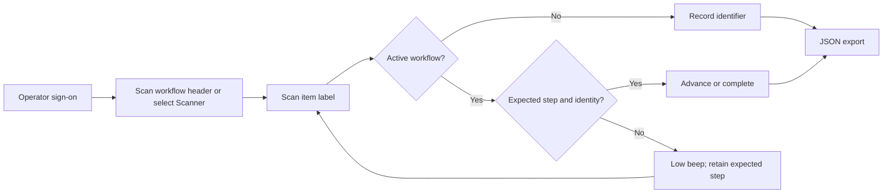
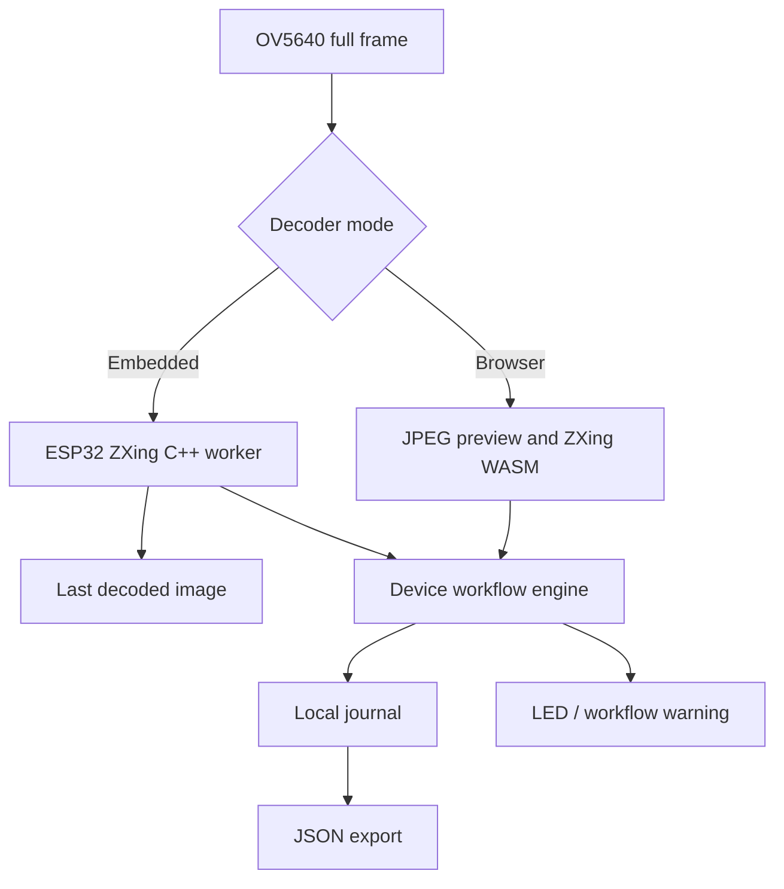
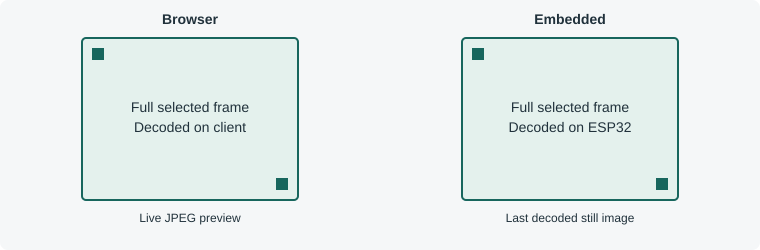

# Manufacturing Test Scanner

A compact ESP32-CAM station for identifying components, verifying assembly and test sequences, and recording traceability data without manual transcription.

<p align="center">


</p>

## Operator workflow

| Sign on | Scan and identify |
| :---: | :---: |
|  | Scan the device or workflow code; the active recipe checks identity and step order. |

Sign on, then scan the instruction-sheet header to launch its recipe or use Scanner for general identification. Correct scans give a short chirp and white LED flash; sequence errors produce a low beep. The final device scan closes the traceability record, including failed measurements. Export JSON for review.



## Assembly demonstration — audible guidance

[](docs/media/assembly-audible.mp4)

[Watch the full 47-second recording with sound](docs/media/assembly-audible.mp4) · [Print the assembly instruction sheet](docs/test-sheets/manufacturing-pipeline.pdf)

The printed sheet becomes the operator's work instruction. After sign-on, the embedded scanner reads the workflow header, captures the device traveler, and verifies six required components. Each accepted part produces a short chirp. A wrong label, repeated component or premature final confirmation produces a low warning tone and leaves the expected step unchanged. Rescanning the original traveler after all six components closes the record.

| Operator action | Scanner response |
|---|---|
| Start recipe from printed header | Rising start tone |
| Scan a new required component | Chirp; record part number, lot and serial |
| Scan the same component again after removing it from view | Reject; do not increment component count |
| Scan another recipe or an unexpected part | Reject; retain expected step |
| Confirm traveler before all six parts | Reject; continue assembly |
| Confirm original traveler after six parts | Completion melody; save traceability record |

In Embedded mode, decoding, sequence validation, audible feedback and local record storage run on the ESP32. A computer can be used for sign-on, monitoring and later export, but is not required for each scan. The buzzer communicates acceptance or rejection; the printed instructions identify the next action. This demonstration uses printed sample labels rather than a production assembly.

| Recording method | Operator interaction | Traceability |
|---|---|---|
| Handwritten | Copy part, lot and serial by hand | Manual checking and later digitization |
| Manual computer entry | Type or copy identifiers into a form | Depends on form validation |
| Embedded scanner | Present each label | Automatic identity/order checks and timestamped records |

Potential benefits are less transcription and immediate error detection. No comparative cycle-time improvement has been measured.

## Manufacturing and test pipelines

| Recipe | Verification |
|---|---|
| Assembly | Six required unique components; confirm original device |
| Functional test | Device, bench, PASS/FAIL measurements; confirm within 60 seconds |
| Thermal setup | Fixture, device, bag, supply, probe, PASS/FAIL temperature result and confirmation |
| Aging | Device, chamber start and stop, device confirmation; exposure timing |

[Four workflow diagrams and instructions](docs/workflows/README.md) · [Four-page operator instructions — revision 02 (PDF)](docs/test-sheets/manufacturing-pipeline.pdf)

## Optical feasibility

| Compact markings | QR density | Size ladder |
| :---: | :---: | :---: |
|  |  |  |

| Marking | Reported bench read |
|---|---|
| QR | 5 × 5 mm, 16 characters |
| Data Matrix | 4 × 4 mm, 16 characters |
| Data Matrix | 8 × 8 mm, 96 characters |
| QR | 10–12 mm, 96 characters remains a candidate; 128-character attempt failed |


These observations include quiet zones and are not qualified operating limits. Repeatability, working distance, print quality, lighting and maximum reliable payload remain uncharacterized. See [test report](docs/TEST_REPORT.md), [per-target evidence](docs/MARKED_RESULTS.md) and [verification plan](docs/VERIFICATION_PLAN.md).

## Architecture





- Both decoders: QR and Data Matrix; Code 128 workflow headers while idle. Browser also supports Code 39. VGA default, up to 1600 × 1200. No intentional center crop.
- Browser: live preview. Embedded: standalone recognition and last decoded still image.
- 192 KiB flash journal; 50 recent native records in RAM; browser-local rules and annotated images.
- GPIO4 illumination, GPIO33 status LED, GPIO13 passive buzzer output. Password-protected dual-slot OTA.

[Hardware and firmware](docs/HARDWARE_AND_FIRMWARE.md) · [Operating instructions](docs/OPERATIONS.md) · [PCB inspection example](docs/inspection/README.md)

## Build

```sh
pio run
pio run -t upload --upload-port PORT
```

Configure Wi-Fi using the device setup AP if needed, then open the scanner address. USB upload: 460800 baud; serial monitor: 115200 baud.

## Repository

| Path | Contents |
|---|---|
| `src/` | ESP32 firmware, camera, workflow engine and HTTP API |
| `web/` | Dashboard, sign-on, parsing and recipe presentation |
| `test/` | Regression tests and optical observations |
| `docs/workflows/` | Process diagrams and recipe details |
| `docs/test-sheets/` | Optical and pipeline test PDFs |
| `docs/media/` | Prototype photographs, demonstrations and equipment illustrations |

## Limits and next steps

Engineering prototype, not production-qualified. Workflow verification checks scanned identifiers, not physical assembly, instrument readings or test execution. Active runs are lost on reboot; the aging example tracks one device per run. Operator sign-on is self-reported; use trusted LAN only. Continuous operation has caused heating. Browser mode reads QR, Data Matrix, Code 128 and Code 39. Embedded mode recognizes Code 128 workflow headers while idle, then uses QR and Data Matrix during an active run. Small printed marks still require physical verification.

Next: fixture API, automated measurement integration, durable run recovery, external storage and timed operator studies. No measured productivity improvement is claimed.

[Changelog](CHANGELOG.md) · [Third-party notices](docs/THIRD_PARTY.md)
