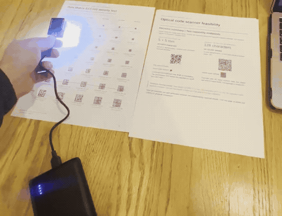
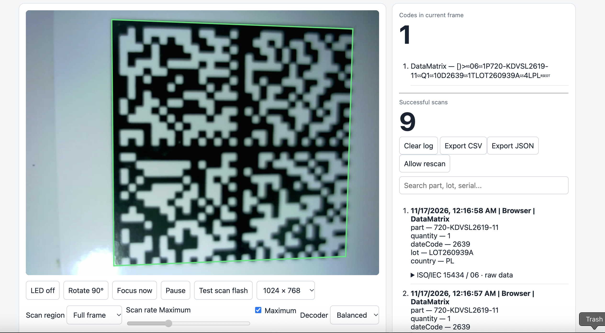
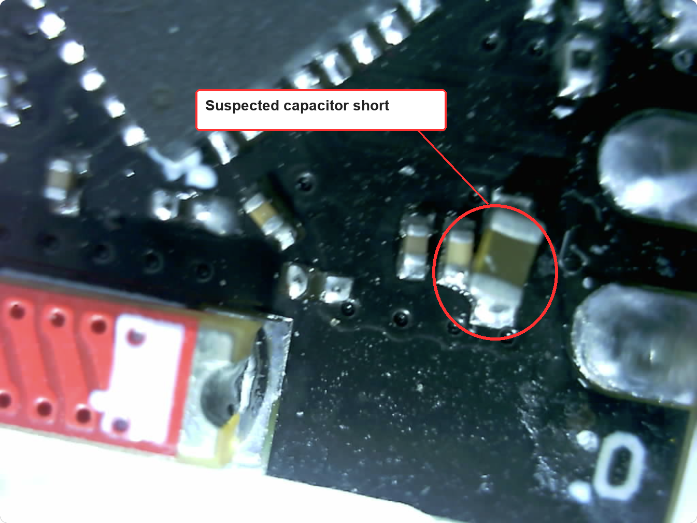

# Manufacturing QR & Data Matrix Scanner

ESP32-CAM and OV5640 scanner for component identification, lot traceability and PCB inspection. Supports browser and native ESP32 decoding over a local network.

| Information density | Compact markings | QR size ladder |
| :---: | :---: | :---: |
|  |  |  |
| [MP4](docs/media/demo-density-scanning.mp4) | [MP4](docs/media/demo-compact-marking.mp4) | [MP4](docs/media/demo-qr-ladder.mp4) |

## Features

- QR, Data Matrix and linear barcode recognition in the browser.
- Embedded QR and Data Matrix decoding using ZXing-C++.
- Browser and Embedded operating modes, searchable manufacturing history, CSV/JSON export and local part lookup.
- Test sign-in with name, department, test, handwritten signature, acknowledgment and compact 15 mm record QR.
- Persistent local archive, camera standby and dual-slot firmware update layout.
- Adjustable color JPEG resolution, scan rate, CPU frequency, Wi-Fi power saving and LED PWM.

## Manufacturing workflow

Scan a part, serial or lot number; associate it with the manufacturing record; capture close-up PCB photographs; circle defects and add notes for inspection, rework and nonconformance reports.

Barcode scanning, preview-frame capture and circle/label annotation are implemented. Persistent local records are supported; MES integration and calibrated macro optics remain planned.

## Manufacturing data parsing

ISO/IEC 15434 Format 06 fields extracted from a component label. The decoded component fields appear alongside the camera view.

## PCB inspection

Operator-reported capacitor short; electrical verification required. [Original image](docs/inspection/pcb-original.png).

## Bench results

| Marking | Footprint | Payload |
|---|---:|---:|
| Smallest reported QR | 5 × 5 mm | 16 characters |
| Smallest reported Data Matrix | 4 × 4 mm | 16 characters |
| Data Matrix density | 8 × 8 mm | 96 characters |
| QR density candidate | 8–12 mm | 96 characters; retest required |

The 128-character QR failed. Dimensions include quiet zones. Results are from printed targets, not production reliability tests.

## Hardware

| Component | Specification |
|---|---|
| MCU | ESP32, 4 MB flash, 4 MB PSRAM detected |
| Camera | OV5640, color JPEG up to 1600 × 1200 |
| Illumination | GPIO4, 20 kHz PWM |
| Browser decoder | ZXing-WASM 3.1.7 |
| Native decoder | ZXing-C++ 2.2.1 |

## Decoder modes

| Mode | Processing |
|---|---|
| Browser | ZXing-WASM on PC or phone |
| Embedded | Native QR/Data Matrix on ESP32 |

Embedded recognition uses the full camera field of view, downsampled to at most 640 × 480 pixels. Native recent history holds 50 entries in RAM; both engines can append raw records to the device archive. Native physical read limits remain unverified. Manufacturing rules and the part lookup are saved in browser storage.

## Setup

1. Install PlatformIO Core and connect the USB serial programmer.
2. Build with `pio run`.
3. Identify the USB port with `pio device list`, then run `pio run -t upload --upload-port <port>`.
4. Open the serial monitor at 115200 baud. For initial setup, join the scanner AP using the password printed in the monitor and configure Wi-Fi at 192.168.4.1.
5. Open the assigned scanner IP in a browser and select the decoder mode.

Prototype runs hot during continuous capture. Stop if excessively hot; use only on a trusted local network.

## Operator and firmware updates

[Operating instructions](docs/OPERATIONS.md) cover test sign-in, signed inspection records and password-protected dual-slot OTA.

## Documentation

- [Hardware and firmware](docs/HARDWARE_AND_FIRMWARE.md)
- [Test report](docs/TEST_REPORT.md) · [Per-target results](docs/MARKED_RESULTS.md) · [Observations CSV](test/observations.csv)
- Test sheets: [Mixed barcodes](docs/test-sheets/manufacturing_barcode_test.pdf) · [QR density](docs/test-sheets/QR_information_density_test.pdf) · [Data Matrix / PCB](docs/test-sheets/PCB_Data_Matrix_and_QR_Test.pdf)
- [Verification plan](docs/VERIFICATION_PLAN.md) · [Trial template](test/trial_template.csv) · [Validation CSV](test/validation_template.csv)
- [Changelog](CHANGELOG.md)
- [Third-party licenses](docs/THIRD_PARTY.md) · [Superseded report](docs/archive/Scanner_System_Validation_SUPERSEDED.pdf)

## Roadmap: manufacturing test automation

The scanner is intended to identify the unit under test, associate it with a test procedure, trigger the appropriate fixture, and preserve measurements and inspection evidence under one traceable record.

| Priority | Planned capability | Automation benefit |
|---|---|---|
| 1 | Fixed camera mount, controlled illumination and physical trigger | Repeatable identification and hands-free acquisition |
| 2 | Unit ID, test ID, fixture ID and run ID | Link each measurement and image to a specific unit and test run |
| 3 | Versioned test recipes and fixture API (HTTP, serial or MQTT) | Automatically select and execute the correct procedure |
| 4 | Test limits, calibration status and pass/fail rules | Consistent decisions with recorded evidence |
| 5 | External database, image storage and offline sync | Durable manufacturing history and MES integration |
| 6 | Automated retries, interlocks and exception handling | Safe recovery, rework routing and duplicate prevention |
| 7 | Validation, throughput and reliability testing | Quantify repeatability before deployment |

Future work also includes thermal and power characterization, optical qualification on production markings, measured scan latency, verified OTA recovery and production access controls. The sign-in acknowledgment is self-reported; it is not authenticated identity or a regulated electronic signature. The roadmap describes planned functionality, not implemented fixture control.
