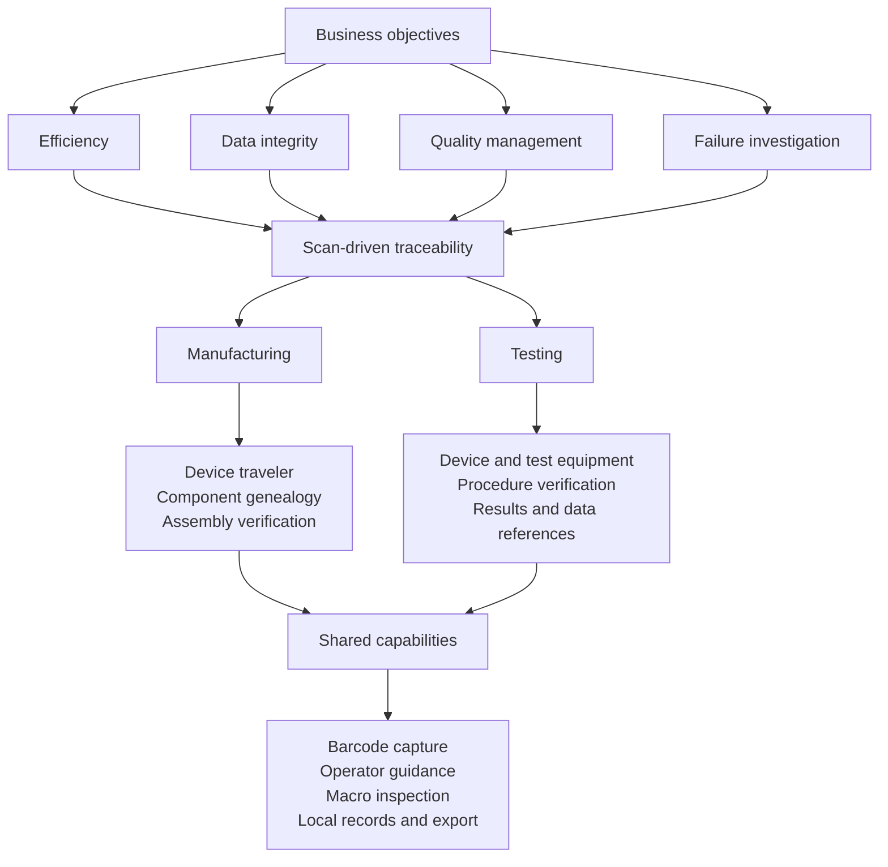
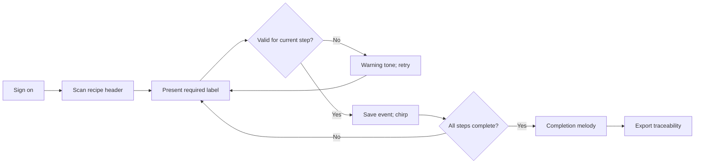
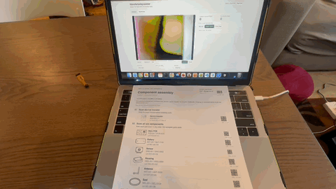
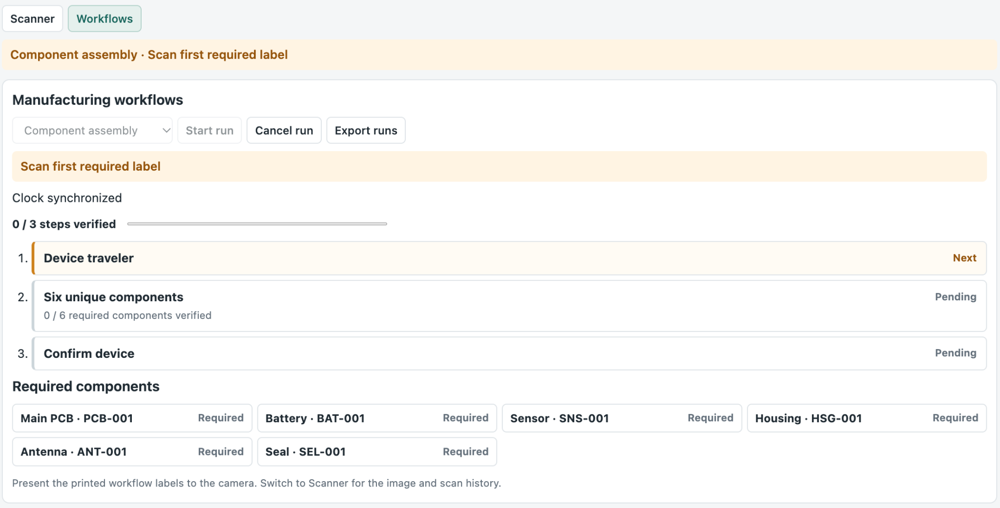
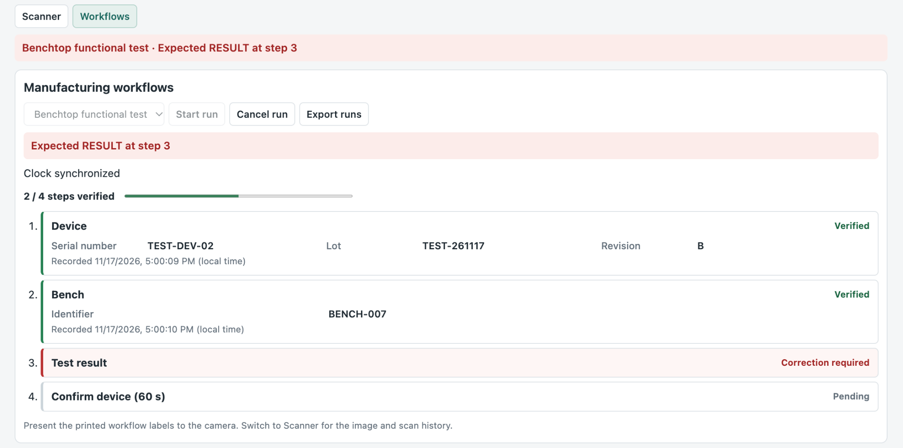
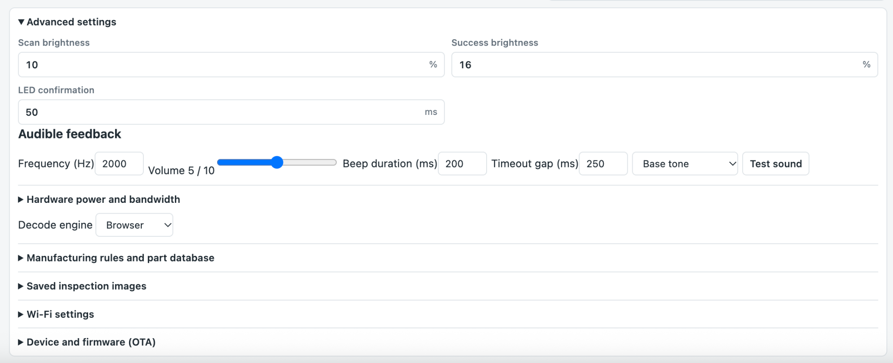
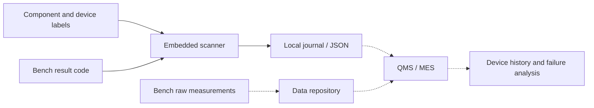

Reduce manual data entry, guide manufacturing and test workflows, and capture traceable records.

## Contents

- [The problem](#the-problem)
  - [Estimated documentation time and potential savings](#estimated-documentation-time-and-potential-savings)
- [The solution](#the-solution)
- [How it works](#how-it-works)
- [Manufacturing and test examples](#manufacturing-and-test-examples)
- [Macro inspection and defect documentation](#macro-inspection-and-defect-documentation)
- [What the scanner records](#what-the-scanner-records)
- [Operator experience](#operator-experience)
- [Scanner settings](#scanner-settings)
- [From device history to failure investigation](#from-device-history-to-failure-investigation)
- [Optical characterization](#optical-characterization)
- [Browser vs. Embedded](#browser-vs-embedded)
- [Getting started](#getting-started)
- [Engineering reference](#engineering-reference)
- [License](#license)

## The problem

For every device, teams need to connect its identity, component lots, test setup, and result.

Manual recording creates two common problems:

| **Time spent recording information** | **Errors in manual records** |
| --- | --- |
|  |  |
| Operators copy serial numbers, lots, equipment IDs, and results instead of assembling or testing devices. | Mistyped identifiers, missing records, and duplicate entries can break the link between a device and its test. |

### Estimated documentation time and potential savings

For a six-component assembly traveler, compare manual documentation with our system’s scan-driven approach:

| Documentation activity | Handwritten | Manual computer entry | Our system (estimated) |
| --- | ---: | ---: | ---: |
| Record and check identifiers | 3–5 min | 2–4 min | **10–60 s** |
| Investigate a missing or incorrect identifier (per incident) | 10–60 min | 1–30 min | 0 min* |

#### Estimated documentation effort — 100 devices

| Activity | Handwritten | Manual computer entry | Our system (estimated) |
| --- | ---: | ---: | ---: |
| Record and check identifiers (100 devices) | 5–8 hr 20 min | 3 hr 20 min–6 hr 40 min | 17 min–1 hr 40 min |
| Investigate 10 manual-entry incidents | 1 hr 40 min–10 hr | 10 min–5 hr | 0 min* |
| **Combined estimated time** | **6 hr 40 min–18 hr 20 min** | **3 hr 30 min–11 hr 40 min** | **17 min–1 hr 40 min** |

Engineering estimates assume 10 manual-entry incidents per 100 devices. *Zero minutes models elimination of transcription-related investigations only. See the [comparative validation protocol](docs/validation/README.md).

## The solution

A low-cost, scan-driven traceability system designed to improve manufacturing and testing by reducing manual data entry, verifying required scan steps and capturing structured records.



The prototype combines an ESP32 and a OV5640 camera, controlled white illumination, passive buzzer, Wi-Fi, and local flash storage. The low-cost camera and lens were modified for close-range, macro-level imaging, enabling compact barcode recognition and detailed PCB inspection with the same hardware. Labels can be printed on travelers, PCBs, components, packaging, and fixtures, or displayed on a computer or electronic-paper screen.

**Phone and offline use:** Open the dashboard from a phone or tablet connected to the scanner’s setup access point or the same local Wi-Fi network. This gives operators a mobile interface without a dedicated PC. Once a workflow is started, Embedded mode continues scanning, validating steps, and saving records locally without an internet connection or an open browser. Export the journal when the dashboard is reachable again.

## How it works



## Manufacturing and test examples

[**Printable work instructions for experimental testing (PDF)**](docs/workflows/instructions.pdf) — print at 100% scale or display digitally.

| Application | Purpose |
| --- | --- |
| [01 — Component assembly](docs/workflows/01-component-assembly/README.md) | Capture device genealogy; prevent duplicate and missing components |
| [02 — Benchtop functional test](docs/workflows/02-benchtop-functional-test/README.md) | Associate device, bench, PASS/FAIL result and measurement reference |
| [03 — Thermal fixture test](docs/workflows/03-thermal-fixture-test/README.md) | Verify fixture, accessories and temperature result |
| [04 — Environmental aging](docs/workflows/04-environmental-aging/README.md) | Record chamber exposure and confirm removal |

### Assembly demonstration

[](docs/media/assembly-audible.mp4)

[Watch the full 47-second demonstration with sound](docs/media/assembly-audible.mp4). The recorded example uses printed labels and the scanner’s embedded workflow. The firmware rejects wrong recipes, unexpected parts, duplicate components, and premature closure. The workflow also guides the operator through visual inspection.

[All workflow details and acceptance criteria](docs/workflows/README.md)

### Barcode scanning demonstrations

| Compact marking | QR density | Size ladder |
| :---: | :---: | :---: |
| [](docs/media/demo-compact-marking.mp4) | [](docs/media/demo-density-scanning.mp4) | [](docs/media/demo-qr-ladder.mp4) |

Compact markings, information density and QR size-ladder testing. [Experimental results and test sheets](docs/characterization/README.md).

## Macro inspection and defect documentation

The modified close-focus camera also captures macro-level PCB images for manual inspection and annotation. Preserve the original image and export the marked copy for test review.

[Inspection procedure and examples](docs/inspection/README.md) · [Scanner settings, Wi-Fi and OTA guide](docs/settings/README.md)


Export original and annotated images from the browser and associate them with the relevant device or test record.

## What the scanner records


Capture device and component identifiers, lots, revisions, equipment, measurements, PASS/FAIL results, data references, operator context and timestamps.

QR and Data Matrix are supported in both modes. Code 128 starts embedded workflows; Browser mode also reads general Code 128 and Code 39.

[Supported formats, encoded payload examples and recognition screenshots](docs/barcodes/README.md)

## Operator experience

The browser dashboard has two views: **Scanner** for camera preview, decoded records and inspection capture; **Workflows** for procedure progress and verification. In Embedded mode, the operator can follow the instruction sheet without keeping the browser open.

### 1. Operator sign-on


Enter the operator, department and test context from a computer or mobile browser.

### 2. Start the procedure

Scan the four-digit Code 128 header from the [shared instruction sheet](docs/workflows/instructions.pdf). The station selects the recipe and displays the required steps.




### 3. Verify components

Present each required label. The station captures part numbers, lots, serials and timestamps; accepted components are marked verified. Embedded mode requires no browser interaction between scans.


### 4. Correct errors

A repeated component, unexpected label or wrong step triggers a warning. The verified component count remains unchanged until the correct label is accepted.


During benchtop testing, the station prompts the operator to scan the expected result label before proceeding.



### 5. Complete and export

Rescan the original device after all requirements are satisfied. The dashboard shows the completed procedure and the operator can export the journal. See the [assembly demonstration](docs/workflows/01-component-assembly/README.md) for the recorded example.


### Audible feedback and operator usability

Distinct sounds let operators keep their attention on the device, components and test equipment instead of repeatedly checking a screen. A short confirmation chirp provides immediate reassurance that each scan was accepted, while a rising completion melody gives a clear sense of progress and accomplishment. Lower warning tones draw attention to rejected scans, and a separate descending melody distinguishes a completed failed test from a passing one.


| Sound | Operator meaning |
| --- | --- |
| Two rising notes | Procedure started; ready to scan |
| Short high chirp | Scan accepted; continue |
| Single low beep | Scan rejected; correct the item or sequence |
| Two low beeps | Confirmation timed out |
| Rising completion melody | Procedure complete successfully |
| Low descending melody | Procedure complete; failed test result recorded |

Distinct signals communicate scan acceptance and test disposition, allowing operators to focus on the device and equipment.

[Operating instructions](docs/OPERATIONS.md) · [Audible settings and electrical details](docs/HARDWARE_AND_FIRMWARE.md)

## Scanner settings



Adjust illumination, confirmation flash, buzzer frequency and volume, camera resolution and decoding mode for the task. Wi-Fi and firmware settings support local configuration and OTA maintenance.

[Configuration values and setup instructions](docs/settings/README.md)

## From device history to failure investigation

A device serial connects component genealogy and test history. The scanner records the equipment identifier, measurement disposition and data reference, alongside operator and time information. In a production integration, the bench would upload raw measurements to a data repository and display a result code with the matching reference. The QMS or MES could join both records to investigate recurring failures by component lot, equipment or hardware revision.



Solid paths show the implemented scanner workflow; dotted paths show the proposed QMS and measurement-data integration.

[Integration architecture, data examples and remaining requirements](docs/integration/README.md)

## Optical characterization

| Format | Observed footprint | Reported payload |
| --- | --- | --- |
| Data Matrix | 4 × 4 mm | 16 characters |
| Data Matrix | 8 × 8 mm | 96 characters |
| QR | 5 × 5 mm | 16 characters |

Initial bench observations for compact printed markings. A 600 DPI or better print process is a practical starting point for further testing.

[Full payload capacity chart, size limits, print-resolution calculations and original test sheets](docs/characterization/README.md)

## Browser vs. Embedded

| | Browser | Embedded |
| --- | --- | --- |
| Recognition | ZXing WASM in connected browser | ZXing C++ on ESP32 |
| Images | Live JPEG preview | Last decoded still |
| Connected browser during scanning | Required | Not required after sign-on |
| Formats | QR, Data Matrix, Code 128, Code 39 | QR, Data Matrix; Code 128 while idle |
| Workflow validation and journal | On device | On device |

Both modes decode the full selected frame, from QVGA up to UXGA (1600 × 1200); VGA is the default. The prototype has a 192 KiB local archive, 50 recent native records in RAM and password-protected dual-slot OTA.

[Hardware and firmware architecture](docs/HARDWARE_AND_FIRMWARE.md) · [PCB inspection example](docs/inspection/README.md)

## Getting started

Build with PlatformIO, install through USB, configure Wi-Fi through the setup AP, and open the device address in a browser.

```sh
pio run
pio run -t upload --upload-port PORT
```

USB upload: 460800 baud. Serial monitor: 115200 baud. Sign on, select Embedded, resume scanning and use the shared instruction PDF.

[Detailed operation and OTA](docs/OPERATIONS.md) · [Verification plan](docs/VERIFICATION_PLAN.md)

[Comparative validation protocol](docs/validation/README.md) · [Changelog](CHANGELOG.md) · [Third-party notices](docs/THIRD_PARTY.md)

## Engineering reference

[Operating constraints and setup](docs/OPERATIONS.md) · [Hardware and firmware](docs/HARDWARE_AND_FIRMWARE.md) · [Test evidence](docs/TEST_REPORT.md)

## License

Original software is **source-available for noncommercial use**, including
personal projects and noncommercial academic teaching and research.
Modification and noncommercial redistribution are permitted with attribution
and preservation of the license terms. Corporate evaluation requires written
permission; internal commercial use and commercial deployment require a
separate license.

[Project license](LICENSE) · [Commercial licensing inquiries](COMMERCIAL_LICENSE.md) · [Third-party notices](docs/THIRD_PARTY.md)
