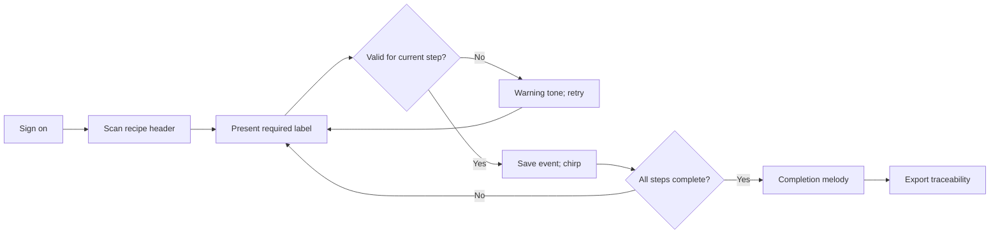
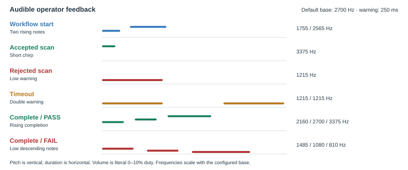
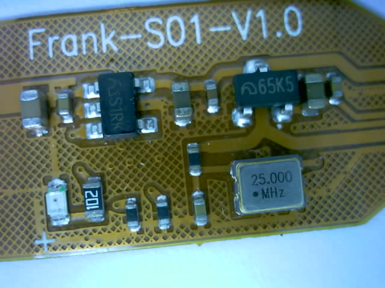
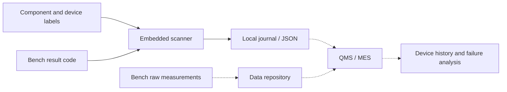

# Manufacturing & Test Traceability Scanner

An ESP32-CAM scanner for validating assembly and test steps, capturing traceability records, and reducing manual data entry. Operate it from a phone, tablet, or computer browser; after setup, scans can be processed and saved locally without internet access.

## Contents

- [The problem](#the-problem)
- [The solution](#the-solution)
- [Estimated documentation time](#estimated-documentation-time)
- [Operator experience](#operator-experience)
- [Manufacturing and test examples](#manufacturing-and-test-examples)
- [Macro inspection and defect documentation](#macro-inspection-and-defect-documentation)
- [From device history to failure investigation](#from-device-history-to-failure-investigation)
- [Optical characterization](#optical-characterization)
- [Browser vs. Embedded](#browser-vs-embedded)
- [Getting started](#getting-started)
- [Production readiness](#production-readiness)
- [License](#license)

## The problem

For every device, teams need to connect its identity, component lots, test setup, and result.

Manual recording creates two common problems:

| **Time spent recording information** | **Errors in manual records** |
| --- | --- |
|  |  |
| Operators copy serial numbers, lots, equipment IDs, and results instead of assembling or testing devices. | Mistyped identifiers, missing records, and duplicate entries can break the link between a device and its test. |

## The solution

Scan existing instructions, component labels and instrument results instead of transcribing them. The scanner checks the expected workflow, provides immediate audible and visual feedback, and stores structured records. After sign-on, Embedded mode does not require a connected computer for each scan.


### What the prototype improves

| Prototype capability | Improvement |
| --- | --- |
| Scan device, component, and lot labels | Capture identifiers without retyping each one |
| Check recipe, sequence, and duplicate scans | Flag unexpected or repeated labels and prevent premature completion |
| Record bench, operator, result, and timestamp | Keep test context linked to the device record |
| Save a local journal and export JSON | Retain records offline and export them when connected |

These are prototype capabilities; production cycle-time and error-rate improvements have not yet been measured.


<p align="center">


</p>

The prototype combines an ESP32 OV5640 camera, controlled white illumination, passive buzzer, Wi-Fi, and local flash storage. The low-cost camera and lens were modified for close-range, macro-level imaging, enabling compact barcode recognition and detailed PCB inspection with the same hardware. Labels can be printed on travelers, PCBs, components, packaging, and fixtures, or displayed on a computer or electronic-paper screen.

**Phone and offline use:** Open the dashboard from a phone or tablet connected to the scanner’s setup access point or the same local Wi-Fi network. This gives operators a mobile interface without a dedicated PC. The scanner does not have a cellular modem: a phone’s cellular-data connection alone cannot reach it. Once a workflow is started, Embedded mode continues scanning, validating steps, and saving records locally without an internet connection or an open browser. Export the journal when the dashboard is reachable again.


## Estimated documentation time

For a six-component assembly traveler (device identification, six part/lot/serial records and final confirmation), a rough planning estimate is:

| Documentation activity | Handwritten | Manual computer entry | Embedded scanning |
| --- | ---: | ---: | ---: |
| Record and check identifiers | 3–5 min | 2–4 min | 10–60 s |
| Investigate a missing or incorrect identifier (per incident) | 10–60 min | 1–30 min | 0 min |

### Estimated documentation effort — 100 devices

| Activity | Handwritten | Manual computer entry | Embedded scanning |
| --- | ---: | ---: | ---: |
| Record and check identifiers (100 devices) | 5–8 hr 20 min | 3 hr 20 min–6 hr 40 min | 17 min–1 hr 40 min |
| Investigate 10 manual-entry incidents | 1 hr 40 min–10 hr | 10 min–5 hr | 0 min* |
| **Combined estimated time** | **6 hr 40 min–18 hr 20 min** | **3 hr 30 min–11 hr 40 min** | **17 min–1 hr 40 min** |

Planning hypothesis: 99% of documentation issues originate from manual entry. This percentage is an assumption to test, not a measured error attribution or reduction rate. The batch example assumes 10 manual-entry incidents per 100 devices for each manual method; the actual incident rate is unknown.

*Zero investigation time applies only to manual transcription errors assumed eliminated by scanning. 

These are illustrative engineering estimates from experience, not measured comparisons. See the [comparative validation protocol](docs/validation/README.md).

## Operator experience

### 1. Operator sign-on


Enter the operator, department and test context from a computer or mobile browser.

### 2. Start the procedure

Scan the four-digit Code 128 header from the [shared instruction sheet](docs/workflows/instructions.pdf). The station selects the recipe and displays the required steps.

### 3. Verify components

Present each required label. The station captures part numbers, lots, serials and timestamps; accepted components are marked verified. Embedded mode requires no browser interaction between scans.

### 4. Correct errors

A repeated component, unexpected label or wrong step triggers a warning. The verified component count remains unchanged until the correct label is accepted.

### 5. Complete and export

Rescan the original device after all requirements are satisfied. The dashboard shows the completed procedure and the operator can export the journal. See the [assembly demonstration](docs/workflows/01-component-assembly/README.md) for the recorded example.



### Audible feedback and operator usability

Distinct sounds let operators keep their attention on the device, components and test equipment instead of repeatedly checking a screen. A short confirmation chirp provides immediate reassurance that each scan was accepted, while a rising completion melody gives a clear sense of progress and accomplishment. Lower warning tones draw attention to rejected scans, and a separate descending melody distinguishes a completed failed test from a passing one.



| Sound | Operator meaning |
| --- | --- |
| Two rising notes | Procedure started; ready to scan |
| Short high chirp | Scan accepted; continue |
| Single low beep | Scan rejected; correct the item or sequence |
| Two low beeps | Confirmation timed out |
| Rising completion melody | Procedure complete successfully |
| Low descending melody | Procedure complete; failed test result recorded |

This feedback is designed to reduce screen dependence, uncertainty and missed errors. An accepted scan confirms record acceptance, not necessarily a passing measurement. The usability benefits have not yet been quantified.

[Operating instructions](docs/OPERATIONS.md) · [Audible settings and electrical details](docs/HARDWARE_AND_FIRMWARE.md)

## Manufacturing and test examples

[**Open the four-workflow instruction PDF**](docs/workflows/instructions.pdf) — print at 100% scale or display digitally.

| Application | Purpose |
| --- | --- |
| [01 — Component assembly](docs/workflows/01-component-assembly/README.md) | Capture device genealogy; prevent duplicate and missing components |
| [02 — Benchtop functional test](docs/workflows/02-benchtop-functional-test/README.md) | Associate device, bench, PASS/FAIL result and measurement reference |
| [03 — Thermal fixture test](docs/workflows/03-thermal-fixture-test/README.md) | Verify fixture, accessories and temperature result |
| [04 — Environmental aging](docs/workflows/04-environmental-aging/README.md) | Record chamber exposure and confirm removal |

### Assembly demonstration

[](docs/media/assembly-audible.mp4)

[Watch the full 47-second demonstration with sound](docs/media/assembly-audible.mp4). The recorded example uses printed labels and the scanner’s embedded workflow. The firmware rejects wrong recipes, unexpected parts, duplicate components, and premature closure. A visual inspection is an operator instruction, not a firmware-verified action. The video demonstrates the scan workflow; phone access is through the local browser dashboard described above.

[All workflow details and acceptance criteria](docs/workflows/README.md)

## Macro inspection and defect documentation

The modified close-focus camera also captures macro-level PCB images for manual inspection and annotation. Preserve the original image and export the marked copy for test review.

| Original macro image | Operator-marked image |
| --- | --- |
|  |  |

[Inspection procedure and examples](docs/inspection/README.md) · [Scanner settings, Wi-Fi and OTA guide](docs/settings/README.md)

Inspection images are browser-local; association with a device or test record is currently manual.

## From device history to failure investigation

A device serial connects component genealogy and test history. The scanner records the equipment identifier, measurement disposition and data reference, alongside operator and time information. In a production integration, the bench would upload raw measurements to a data repository and display a result code with the matching reference. The QMS or MES could join both records to investigate recurring failures by component lot, equipment or hardware revision.



Solid paths represent prototype capabilities; dotted paths represent proposed external integration. The scanner does not currently operate instruments, retrieve raw signals or connect to a live QMS.

[Integration architecture, data examples and remaining requirements](docs/integration/README.md)

## Optical characterization

Compact markings enable traceability on space-constrained PCBs. Our initial bench observations target QR footprints of 5–15 mm and Data Matrix down to 4 mm.

| Compact marking | QR density | Size ladder |
| :---: | :---: | :---: |
|  |  |  |

| Format | Footprint | Payload / observation |
| --- | --- | --- |
| Data Matrix | 4 × 4 mm | 16 ASCII characters reported read |
| Data Matrix | 8 × 8 mm | 96 characters reported read |
| QR | 5 × 5 mm | 16 characters reported read |
| QR | 10–12 mm | 96-character candidate; 128-character attempt failed |
| QR-M | 15 × 15 mm | PCB-002 (7 characters) reported read; maximum payload unknown |


A 5 mm QR V1/M size-ladder code was also successfully recognized (4-character P:05). Its nominal 172 µm module pitch corresponds to about four dots per module at 600 DPI, an engineering target rather than a measured printer specification. For production exploration, start with 600 DPI or better, short Data Matrix identifiers on compact PCBs and larger QR labels for richer records. Print resolution is a practical constraint, but higher DPI alone does not guarantee recognition. Print quality, optics, focus and field of view have not been isolated experimentally. These are qualitative bench observations, not guaranteed operating limits.

[Characterization, original test sheets and evidence](docs/characterization/README.md)

## Browser vs. Embedded

| | Browser | Embedded |
| --- | --- | --- |
| Recognition | ZXing WASM in connected browser | ZXing C++ on ESP32 |
| Images | Live JPEG preview | Last decoded still |
| Connected browser during scanning | Required | Not required after sign-on |
| Formats | QR, Data Matrix, Code 128, Code 39 | QR, Data Matrix; Code 128 while idle |
| Workflow validation and journal | On device | On device |

Both modes decode the full selected frame, from QVGA up to UXGA (1600 × 1200); VGA is the default. The prototype has a 192 KiB local archive, 50 recent native records in RAM and password-protected dual-slot OTA.

[Hardware and firmware architecture](docs/HARDWARE_AND_FIRMWARE.md) · [PCB inspection example](docs/inspection/README.md)

## Getting started

Build with PlatformIO, install through USB, configure Wi-Fi through the setup AP, and open the device address in a browser.

```sh
pio run
pio run -t upload --upload-port PORT
```

USB upload: 460800 baud. Serial monitor: 115200 baud. Sign on, select Embedded, resume scanning and use the shared instruction PDF.

[Detailed operation and OTA](docs/OPERATIONS.md) · [Verification plan](docs/VERIFICATION_PLAN.md)

## Production readiness

This is an engineering prototype, not a qualified manufacturing or regulated QMS system.

**Demonstrated:** on-device scan decoding and workflow checks, operator feedback, local event journaling, JSON export, and browser access from a phone or computer on the scanner’s Wi-Fi/LAN. The scan loop can continue without internet access.

**Gaps before production use:** operator sign-on is self-reported; HTTP is unencrypted; active runs do not recover after reboot; local archive capacity is limited; and scans do not prove physical assembly or instrument accuracy. Instrument control, raw-data capture, and live QMS/MES or cloud sync are not implemented. Cellular data alone cannot reach the scanner.

**Next validation work:** measure cycle time and entry-error rates in a controlled comparison; characterize decode reliability across label sizes, print quality, lighting, and placement; verify restart recovery and archive retention; then add authenticated access, protected transport, instrument/data-system integration, and a supported record backup path.

[Comparative validation protocol](docs/validation/README.md) · [Changelog](CHANGELOG.md) · [Third-party notices](docs/THIRD_PARTY.md)

## License

Original software is **source-available for noncommercial use**, including
personal projects and noncommercial academic teaching and research.
Modification and noncommercial redistribution are permitted with attribution
and preservation of the license terms. Corporate evaluation requires written
permission; internal commercial use and commercial deployment require a
separate license.

[Project license](LICENSE) · [Commercial licensing inquiries](COMMERCIAL_LICENSE.md) · [Third-party notices](docs/THIRD_PARTY.md)
