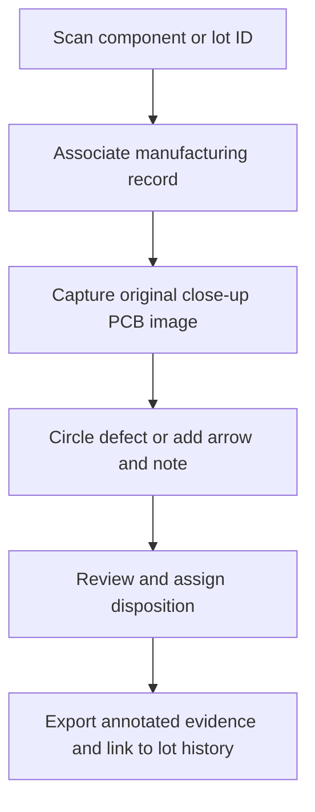
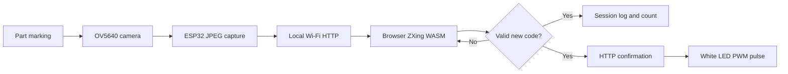

# Manufacturing QR & Data Matrix Scanner

**ESP32-CAM / OV5640 | Rev 02 | Preliminary feasibility, 16 November 2026**

Low-cost optical manufacturing documentation station for part and lot identification, traceability, and close-up PCB inspection. An ESP32-CAM acquires JPEG images over local Wi-Fi; the connected browser uses ZXing WebAssembly to decode one QR code, Data Matrix or supported linear barcode per frame. No cloud decoder or SD card is required. Present a part at any orientation, recognize its identifier, pulse the illumination, record a session event and continue.

> Prototype only. Not yet production-qualified or standalone. The browser performs recognition. The board has exhibited excessive heating; disconnect power if uncomfortably hot and do not operate unattended. Private pending public-release review.

## Intended manufacturing workflow

Use one optical station to identify a component or board, link its serial/part/lot identifiers to manufacturing records, and document inspection findings. Compact QR or Data Matrix identifiers serve as keys into a future manufacturing execution system (MES), rather than embedding an entire device history in a tiny symbol.

| Use case | Intended workflow | Status |
|---|---|---|
| Part and lot identification | Scan a compact QR/ECC200 marking, display decoded ID and time | Prototype demonstrated on printed samples |
| Manufacturing traceability | Associate part, lot, serial, revision, workstation, operator and process outcome with a traceability record | Session log and CSV exist; persistent MES/database integration planned |
| PCB inspection photography | Capture high-resolution close-up still images of solder joints, pads, traces, connectors and component placement | Live JPEG preview exists; dedicated snapshot and calibrated macro/microscope optics planned |
| Visual defect documentation | Circle or outline a defect, draw arrows, add text/labels, zoom/crop and adjust display contrast | Planned annotation editor; not implemented |
| Inspection record | Preserve original image, annotation layer, edited export, timestamp, part/lot ID and finding/disposition | Planned controlled evidence workflow |

### PCB inspection and annotation concept

The OV5640 prototype is a candidate for close-up inspection, not a calibrated microscope. To achieve microscope-level detail, select appropriate macro optics, working distance, stable fixture, diffuse illumination and a calibrated scale target. Demonstrate resolvable feature size before claiming magnification or defect-detection performance.

The proposed editor retains the untouched original JPEG and stores annotations non-destructively as image-coordinate geometry with text, author and time. Export a marked-up copy for manufacturing travelers, nonconformance reports, rework instructions and inspection documentation. Cropping, brightness and contrast changes must be documented; no editing should obscure or misrepresent an original defect.

Example record fields: part ID, lot, board serial, revision, station, operator, UTC timestamp, image UUID, finding annotation, disposition, and source image hash. Database, file retention, access controls, audit trail and report export remain future work.

The diagram describes the intended workflow, not features already implemented.

## Key findings

| Objective | Experimental evidence |
|---|---|
| Smallest QR | 5 × 5 mm, 16 ASCII characters (L052, V1); P:05 also read |
| Smallest Data Matrix ECC200 | 4 × 4 mm, 16 characters |
| Largest reported Data Matrix payload | 96 characters at 8 × 8 mm; 10 mm also reported, with a conflicting FOV observation |
| Largest QR payload | 128-character test failed on follow-up; 96-character candidate inferred from prior version cutoffs, needs explicit confirmation |
| PCB mockup | 6, 8 and 10 mm footprints reported readable on printed 10 mm PCB mockup |

All square dimensions include quiet zones. These are observed reads, not validated detection probabilities. Below 4 mm and maximum QR capacity remain open test questions.

## Documentation

- [Hardware and firmware specification](docs/HARDWARE_AND_FIRMWARE.md)
- [System test report and corrected conclusions](docs/TEST_REPORT.md)
- [Verification plan and ±5% tolerance](docs/VERIFICATION_PLAN.md)
- [Original mixed barcode and QR test PDF](docs/test-sheets/manufacturing_barcode_test.pdf)
- [Per-target marking results and evidence rules](docs/MARKED_RESULTS.md)
- [QR density test PDF](docs/test-sheets/QR_information_density_test.pdf)
- [Data Matrix / PCB comparison PDF](docs/test-sheets/PCB_Data_Matrix_and_QR_Test.pdf)
- [Historical report PDF — superseded](docs/archive/Scanner_System_Validation_SUPERSEDED.pdf): contains the corrected 128-character claim; do not use as acceptance specification.
- [Reported observations CSV](test/observations.csv)
- [Trial recording template](test/trial_template.csv)
- [Third-party notices](docs/THIRD_PARTY.md)

## Quick start

1. Install PlatformIO Core and connect the ESP32-CAM using a compatible USB serial programmer.
2. Run `pio run`, then `pio run -t upload --upload-port <your-serial-port>`. Use `pio device list` to find the port; reduce upload speed if necessary.
3. Open the serial monitor at 115200. For initial provisioning, join the setup AP using the password printed locally in the serial monitor. Open 192.168.4.1 and configure the local 2.4 GHz network.
4. Reconnect to the network and open the scanner IP printed in the serial monitor. Use a modern browser on the same trusted network.
5. Set resolution, region, scan rate, decoder effort and LED PWM. Present one code at a time. Export the browser session log as CSV if necessary; refreshing or closing the browser discards the session.

## Architecture

## Roadmap

Implement snapshot capture and non-destructive annotation, lot/serial record linking and inspection export. Validate minimum marking size, QR payload ceiling, optical/print resolution, repeated reads and motion tolerance; measure power and component temperature; qualify actual PCB marks; implement safe physical trigger and buzzer; evaluate standalone scan engine; complete security and third-party licensing review before public release.
