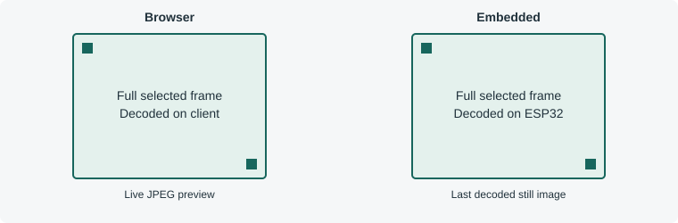

# Hardware and firmware specification

| Item | Configuration |
|---|---|
| MCU | ESP32-D0WD-V3, 240 MHz maximum; AI Thinker-style ESP32-CAM |
| Memory | Detected 4 MB flash and approximately 4 MB PSRAM |
| Camera | OV5640 5 MP nominal; autofocus actuator movement is unverified |
| Programmer | ESP32-CAM-MB / USB serial adapter |
| Resolution | QVGA, CIF, VGA (default), SVGA, XGA, UXGA 1600 × 1200 |
| Storage | Preferences, 50 recent native records, 192 KiB LittleFS archive |
| Toolchain | PlatformIO espressif32 6.13.0, Arduino ESP32 2.0.17 |

## Recognition pipeline

| Mode | Decoder | Scan area |
|---|---|---|
| Browser | ZXing-WASM 3.1.7; QR, Data Matrix | Full selected frame |
| Embedded | ZXing-C++ 2.2.1; QR and Data Matrix | Full selected frame |

The camera captures the selected resolution in both modes. Browser mode transfers JPEG frames; Embedded mode runs ZXing-C++ in a worker and makes the last decoded image available. Neither mode intentionally crops the image.

Requested scan rate is 1–30 FPS or maximum; actual throughput depends on acquisition, JPEG conversion and recognition. Earlier native timing was approximately one second per frame, not a current benchmark.

CPU speed (80/160/240 MHz), Wi-Fi power saving, JPEG quality (8–30), illumination and confirmation durations are configurable.

## Camera and illumination

The low-cost OV5640 camera and lens were modified for close-range macro imaging. This optical adaptation supports both compact barcode reading and visual inspection of small PCB features without a separate microscope or industrial imaging system for the demonstrated tasks. Working distance, magnification, depth of field and optical resolution have not yet been quantified.

- OV5640 camera clock: 20 MHz; JPEG capture with two PSRAM frame buffers when available.
- White LED: GPIO4, 20 kHz PWM. Defaults to 10% scan brightness and 50% confirmation brightness for 80 ms.
- Red LED: GPIO33, active-low workflow warning.
- Autofocus firmware initialization is observed; physical actuator movement and power are unverified.
- QVGA transfer averaged 161 ms over five frames in an earlier measurement. Later buffering changes have not been benchmarked.

## Board constraints

Camera signals use GPIOs 0, 5, 18, 19, 21–27, 32, 34–39. GPIO0 is a boot strap and camera clock output; the onboard GPIO0 button corrupted camera frames during operation and is not a runtime trigger. GPIO13 is assigned to a passive buzzer using hardware PWM (LEDC channel 6), independently of camera and illumination timers. Use a suitable driver if the transducer exceeds GPIO electrical limits. A physical trigger is not implemented. Future SD storage must use 1-bit mode (GPIO2, 14, 15) to preserve GPIO13 and the illumination output. Verify electrical compatibility before connecting the card.

## Operational limits

Continuous operation caused excessive heating. Input current and component temperatures have not been measured. Do not operate unattended; stop if the board becomes excessively hot. Browser mode enters standby after 15 seconds without frame requests.

The device archive is bounded at 192 KiB and does not automatically overwrite old records. Export before it fills.

## Network and security

The local interface uses unencrypted HTTP. Test sign-in is self-reported; it does not authenticate identity or provide a protected audit record. Wi-Fi credentials are stored in Preferences, and the setup AP password is printed to the serial monitor. Use a trusted local network and synthetic data for demonstrations.

Before production, define and verify authenticated provisioning, credential protection, signed updates, secure boot, flash encryption, thermal limits, camera focus, and a recovery process.