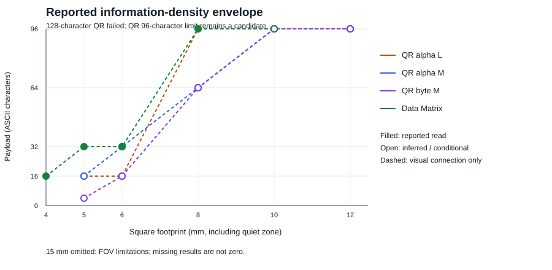

# Optical marking feasibility — Rev 02

Operator-reported bench tests, November 16, 2026. Supersedes earlier report's provisional 128-character QR conclusion.

## Objectives

Minimize square component marking area while retaining a useful identifier; maximize data within a single square QR or ECC200 symbol. All footprints include quiet zones. The smallest reported standard QR is 5 mm with 16 ASCII characters (L052); the smallest Data Matrix is 4 mm with 16 characters. The best explicit Data Matrix payload is 96 characters at 8 mm. The later 128-character QR read failed; 96 is an inferred candidate, not a confirmed maximum.

## Method

Original test sheets: QR sizes 4,5,6,8,10,12,15 mm with 4,16,32,64,96,128 ASCII characters; alphanumeric M, alphanumeric L and byte M. Data Matrix square ECC200 sizes 4–15 mm, payloads 7,16,32,64,96. Print at 100% scale, cover adjacent codes, present one at a time. Exact repeats, distance, printer DPI, exposure, light and camera parameters were not recorded for each sample. Results are qualitative successful reads, not measured reliability.

QR V has 17+4V active modules and a four-module quiet zone on each edge: module pitch (µm) = 1000 × side_mm/(25+4V). Data Matrix with N modules and one-module quiet zone: pitch = 1000 × side_mm/(N+2). Area = side_mm². ASCII character count equals bytes in these samples.

## QR results

Version labels mapped against original printed PDF. L-prefixed sample IDs anchor the first group's assignment; other groups interpreted in stated page order. Payloads inferred from version cutoffs are not independently logged reads.

| Side (mm) | Alpha L | Alpha M | Byte M |
|---:|---|---|---|
| 4 | Not reported | Not reported | Not reported |
| 5 | V1 (16; L051/L052 reported) | V1 (16) | V1 (4) |
| 6 | V1 (16; L061/L062) | V2 (32) | V2 (16) |
| 8 | V4 (96); V5 failed | V4 (64) | V5 (64) |
| 10 | All earlier; 128 later failed (96 candidate) | V6 earlier; 96 candidate | V6 (96) |
| 12 | All earlier; 96 candidate | V6 earlier; 96 candidate | V8 earlier; 96 candidate |
| 15 | Failed in reported density group | Not isolated | Not isolated |

The later 128 failure scope across encodings and sizes is unspecified. Do not count any 128-character sample as a verified maximum. Separate compact PCB QR test did read 15 mm; FOV limits depend on geometry and focus distance.

## Data Matrix results

| Side (mm) | Greatest reported readable characters |
|---:|---:|
| 4 | 16 |
| 5 | 32 |
| 6 | 32 |
| 8 | 96 |
| 10 | 96, conditional: also reported too large for camera window |
| 12 | FOV limited |
| 15 | Not reported |

PCB-002 compact comparison (seven characters): Data Matrix 5,8,10 mm pass, 15 mm too large; QR-M all four sizes pass, pitches 172–517 µm. Printed 10 mm PCB mockup: 6,8,10 mm markings all read. Actual fabricated board qualification not performed.

## Capacity envelope

Points are reported reads or mapped cutoffs; dashed lines connect observations rather than predict guaranteed capacity. The 128-character failure supersedes the historical PDF. No validated absolute maximum QR payload exists yet.

## Examples

| Candidate marking | Example | Evidence |
|---|---|---|
| 5 mm QR | P:05 | 4 characters explicitly decoded |
| 5 mm QR / Data Matrix | PCB-002 | 7 characters, comparison read |
| 4–5 mm Data Matrix | PCB-002/LOT26A01 | 16 characters; capacity demonstrated, exact example not tested |
| 8–12 mm QR / Data Matrix | PART=PCB002;LOT=26A;SN=000123;REV=B;DATE=20261116;LINE=01;STATION=02;TEST=PASS | Example compact manufacturing record; not physically tested |

Use a compact ID linked to a manufacturing database for tiny components. At 5 mm, marking occupies 25% of a 10 mm PCB; at 8 mm, 64% with 1 mm margin per edge. Prefer 5 mm ECC200 / 16 characters as conservative initial design; higher-capacity 8 mm ECC200 / 64–96 characters for richer records. Validate before production.

## Print and optical limits

V1 QR at 4 mm has 138 µm pitch (1.6 printer dots/module at 300 DPI, 3.3 at 600 DPI). ECC200 18×18 at 4 mm gives 200 µm pitch (2.4 and 4.7 dots). Printer distortion, focus, contrast, motion and FOV have not been separated. Use microscope comparison and controlled illumination; smaller marking sizes remain exploratory.

## Limitations and next decision

No repeated-read probability, false-read rate, independent sensor FPS, swipe speed, focus range, power or temperature data. Exact 128-character failure and 10 mm Data Matrix FOV contradiction need retests. ±5% dimensional tolerance and 19/20 success are proposed screening criteria, not demonstrated. Prior report retained in archive for traceability, not current specification.
