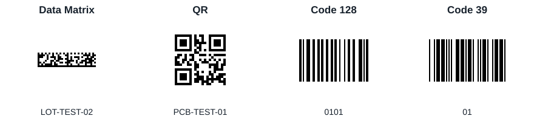
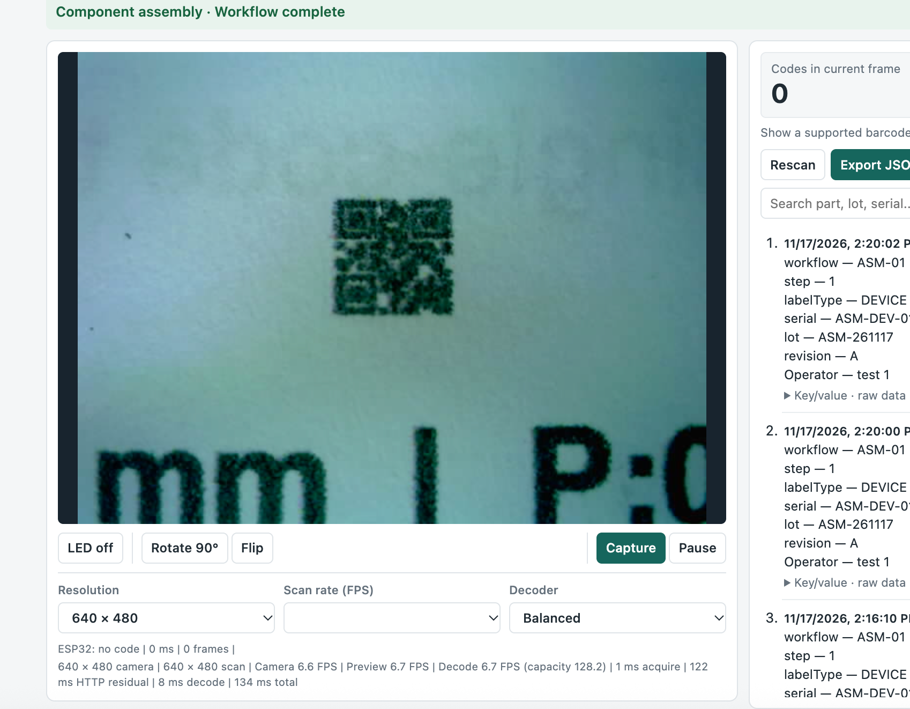
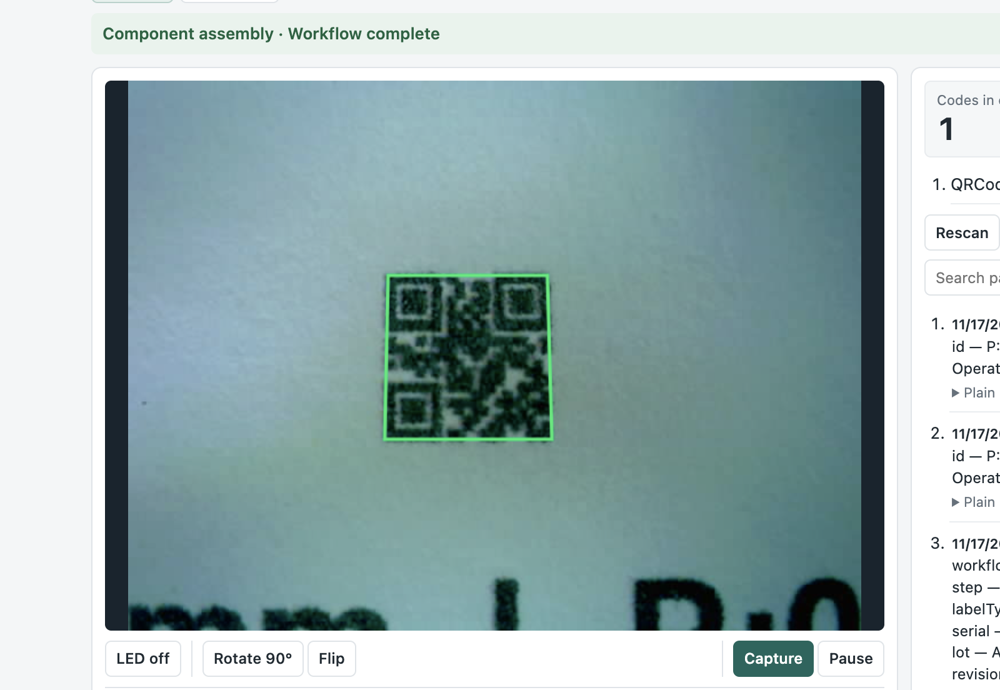

# Supported barcode formats and recorded data

The symbol format determines how information is encoded; the payload determines what the scanner records. The same structured manufacturing payload can be encoded in QR or Data Matrix.

| Format | Example payload | Browser | Embedded |
| --- | --- | --- | --- |
| Data Matrix | `LOT-TEST-02` | Yes | Yes |
| QR | `PCB-TEST-01` | Yes | Yes |
| Code 128 | `0101` | Yes | Workflow headers while idle |
| Code 39 | `01` | Yes | No |

## Recognition in operation

| Camera preview | Recognized QR code |
| --- | --- |
|  |  |

Actual browser captures from the compact QR size-ladder test.

## Structured label examples

| Record | Example encoded payload |
| --- | --- |
| Component | `PN=PCB-001;LOT=PCB-261101;SN=PCB-0025` |
| Device | `SN=ASM-DEV-01;LOT=ASM-261117;REV=A` |
| Equipment | `ID=BENCH-007` |
| Electrical result | `ID=RUN-0262P;STATUS=PASS;V=5.02V;I=62mA;DATA=RUN-0262P` |
| Thermal failure | `ID=RUN-0263F;STATUS=FAIL;T=38.4C;REASON=TEMP_HIGH` |

These compact examples illustrate the general parser. A controlled workflow additionally requires recipe, step, label type and the appropriate identity fields. For complete scannable workflow labels, use the [shared instruction PDF](../workflows/instructions.pdf).

### Payload examples at reported scan lengths

| Trial result | Example payload |
| --- | --- |
| Data Matrix, 4 × 4 mm — 16 ASCII bytes | `SN=000123;LOT=26` |
| QR, 5 × 5 mm (error correction L) — 16 ASCII bytes | `DEVICE=SN000123A` |
| Data Matrix, 8 × 8 mm — 96 ASCII bytes | `PART=PCB002;LOT=26A;SN=0000123;REV=B;DATE=20261118;LINE=001;STATION=002;TEST=PASS;OP=AB;SHIFT=01` |

These example strings are sized to match payload lengths reported in the trials; the exact strings shown here were not necessarily the ones scanned. They use ASCII, so each character is one byte. Reported scan lengths are observed results, not the standard's maximum capacity. Actual readable capacity depends on symbol type, size, print quality, error correction and scan conditions.

The browser parser also supports plain identifiers, flat JSON, semicolon-separated key/value fields, ISO/IEC 15434 format 06 with supported data identifiers, and configurable prefix/separator rules. Recognized fields include part, lot, serial, quantity, date code, country, supplier, revision, device, equipment, chamber, test result, measurement values and data reference. Unknown formats can be retained as raw identifiers or payloads; recognition is not certification of compliance with a barcode standard.

The scanner adds operator context, timestamps and workflow events to its records. It does not retrieve external measurement files or automatically link inspection images to a workflow.

[Original test sheets](../test-sheets/) · [Characterization](../characterization/README.md)
