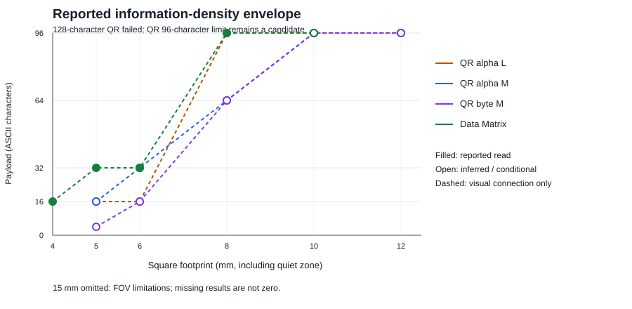
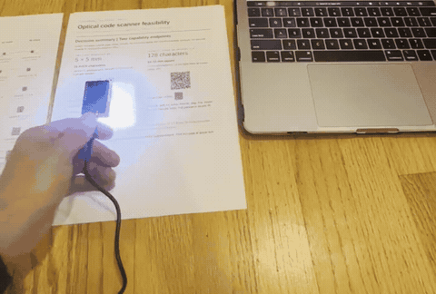
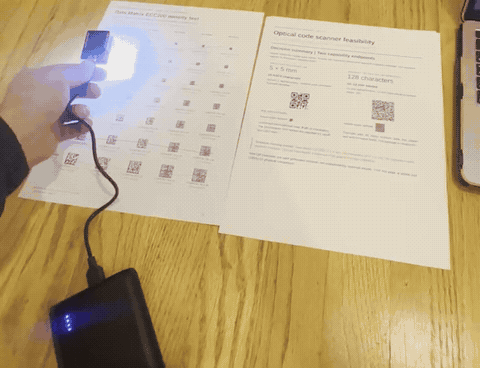
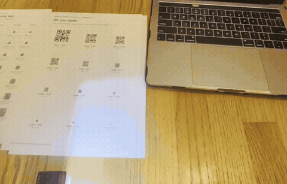

# Optical characterization

The initial goal is a practical marking envelope for prototype assembly and test: QR at 5–15 mm and compact Data Matrix down to 4 mm for identifier marking on PCBs.

| Format | Footprint including quiet zone | Reported result |
| --- | --- | --- |
| Data Matrix | 4 mm | 16 characters |
| Data Matrix | 5–6 mm | 32 characters |
| Data Matrix | 8 mm | 96 characters |
| Data Matrix | 10 mm | Conditional 96-character report; field-of-view conflict |
| QR V1/M | 5 mm | P:05 (4 characters) size-ladder read; new successful recognition screenshot |
| QR | 5 mm | 16 characters (alphanumeric L reported; M inferred) |
| QR | 8 mm | Up to 96 characters reported for alphanumeric L; inferred cutoff |
| QR | 10–12 mm | 96-character candidates; 128-character failure not isolated |
| QR-M | 15 mm | PCB-002 (7 characters) reported read in separate comparison; maximum unknown |

These are qualitative operator-reported observations, not guaranteed limits. Exact encoding, error correction, quiet zone and print quality affect payload density. A compact identity code can reference a richer external record rather than embedding every field.

The camera and lens were modified for close-range macro imaging to make compact printed symbols occupy more of the sensor frame. This is a low-cost optical approach rather than digital enlargement alone. Working distance, optical magnification and depth of field remain uncharacterized. The test sheets were printed using a Canon PIXMA MG3620 inkjet at the high-quality computer print setting, rated up to 600 × 600 DPI black and 4800 × 1200 DPI color ([Canon PIXMA MG3620 specifications](https://www.usa.canon.com/support/p/pixma-mg3620)). Print fidelity is a potential constraint; 4 mm Data Matrix with 16 ASCII characters is the smallest demonstrated compact result in this setup. This does not establish a camera-only resolution limit. Contrast, print resolution, focus distance, full-frame field of view, exposure and motion have not been separated. Direct marking on manufactured PCBs remains unqualified.

[Plotted observations (CSV)](optical-results.csv). The chart shows the four density series; short-code observations remain in the table and CSV. Coincident markers are offset horizontally for readability only; lines use the exact coordinates. Evidence status is retained in the CSV.

## Printing and module resolution

The latest 5 mm QR V1/M size-ladder screenshot shows a recognized QR with visible edge irregularity; it is not a calibrated printer-resolution measurement. Version 1 has 21 active modules per side, plus four quiet-zone modules per edge. Assuming nominal footprint includes quiet zone, module pitch is 5 mm / 29 = 172.4 µm.

| Nominal printer DPI | Dot pitch | Dots per 5 mm QR module |
| ---: | ---: | ---: |
| 300 | 84.7 µm | 2.04 |
| 600 | 42.3 µm | 4.07 |
| 1200 | 21.2 µm | 8.15 |

Four dots per module would require approximately 589 DPI; 600 DPI therefore matches the nominal black printer rating, but is not a measured effective resolution or validated minimum. The 4 mm ECC200 example (18 active modules plus two quiet-zone modules, if that symbol size applies) has 200 µm pitch, or 4.72 dots per module at 600 DPI. Ink spread, camera blur and compression cannot be separated from the screenshots alone. Measure a calibrated printed target to determine effective resolution; the color DPI rating does not establish monochrome detail.

## Recommended marking choices

| Location | Initial design | Reason |
| --- | --- | --- |
| Compact PCB or small component | 4–5 mm Data Matrix; short unique identifier | Smaller footprint; 4 mm / 16 characters reported read |
| Traveler, packaging or equipment | 5–15 mm QR, sized for actual payload | Larger labels provide more module area |
| Instrument result display | QR with unique run reference; optional summary fields | Link to authoritative measurement files without encoding entire datasets |

Use a nominal 600 DPI or better print process as a starting point, actual-size output, intact quiet zones and high contrast. At 4 mm QR V1, four dots per module would require about 737 DPI; denser codes may need more. A 1200 DPI process is a useful comparison, not a proven solution. Small ID-only labels require an external lookup for richer metadata; the current workflow parser expects its defined fields, so this lookup design is proposed rather than implemented.

[Full module-pitch calculations and marking recommendations](../TEST_REPORT.md#print-resolution-and-practical-marking-design).

## Evidence and reproduction

| Compact marking | QR density | Size ladder |
| :---: | :---: | :---: |
|  |  |  |

Compact markings, information density and QR size-ladder testing.

- [Compact marking demonstration](../media/demo-compact-marking.mp4)
- [QR density demonstration](../media/demo-density-scanning.mp4)
- [Size ladder demonstration](../media/demo-qr-ladder.mp4)
- [Original mixed test sheet](../test-sheets/manufacturing_barcode_test.pdf)
- [PCB marking sheet](../test-sheets/PCB_Data_Matrix_and_QR_Test.pdf)
- [QR density sheet](../test-sheets/QR_information_density_test.pdf)
- [Detailed report and methodology](../TEST_REPORT.md)
- [Per-target observations and uncertainty](../MARKED_RESULTS.md)
- [Verification plan](../VERIFICATION_PLAN.md)

Print at 100% scale and present one symbol at a time. Record actual dimensions, printer settings, working distance, resolution, illumination, decode mode, time to read, failures and repetitions. Repeat with higher-quality marking to separate printer from optical constraints. No statistical maximum payload, repeatability or throughput has been established.
