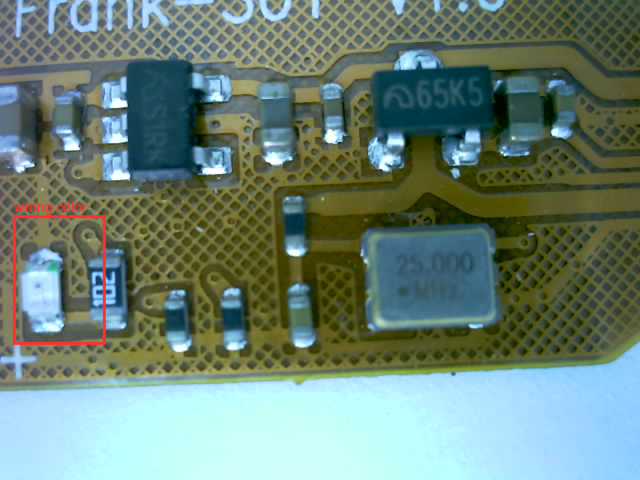
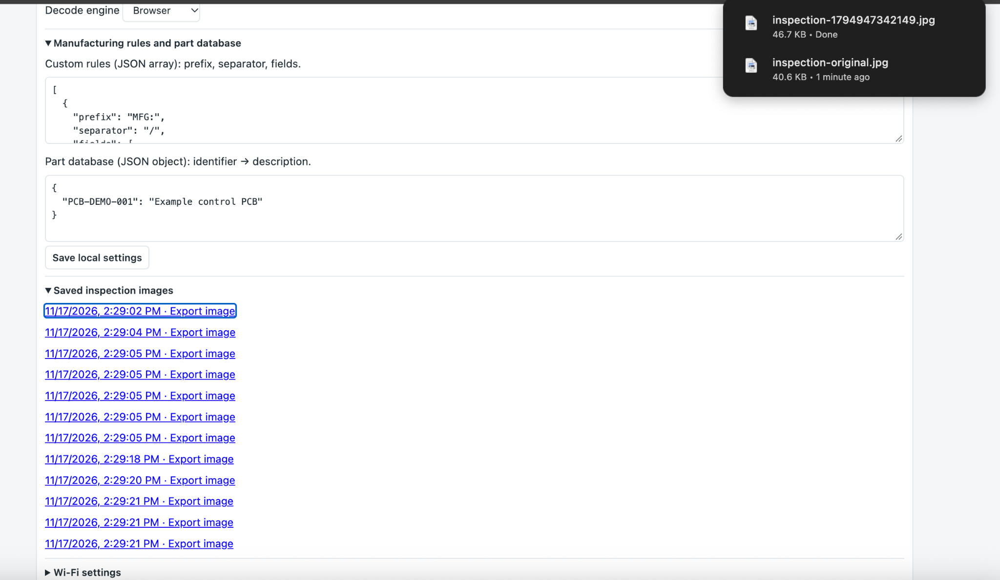

# PCB inspection example

| Original | Marked finding |
|---|---|
|  |  |

Operator-reported short at the right-side capacitor cluster. Verify with power removed and resistance/continuity measurements; the photo alone does not establish an electrical short. Original screenshot cropped to the camera image and exported without metadata. The annotated copy adds only a circle and label.

## Inspection record
Associate each original photograph and its separate annotation with part, lot, serial, operator, timestamp, finding and disposition. Preserve original pixels for review.

## Macro capture and manual defect labeling

The modified camera and lens provide close-range macro views of PCB components and solder joints using the same inexpensive scanner hardware for manual inspection and documentation.

| Original camera export | Annotated export |
| --- | --- |
|  |  |

[Saved inspection image export](macro-saved.jpg).

1. Select Browser decoding for the live preview, position the board and adjust illumination until the region is visible.
2. Select **Capture**, choose Circle or Rectangle, enter a finding label and mark the region. Use Undo to correct annotations.
3. Select **Export original** to retain the unmarked image and **Save** to retain the marked image. Retrieve saved images from Advanced settings → Saved inspection images.

Operator annotations document visual findings. Associate exported image filenames with the device serial, run ID and finding to support a test or nonconformance record. Images are saved in the browser; export both copies before clearing browser data. See [settings guide](../settings/README.md).

## Inspection interface and saved images

