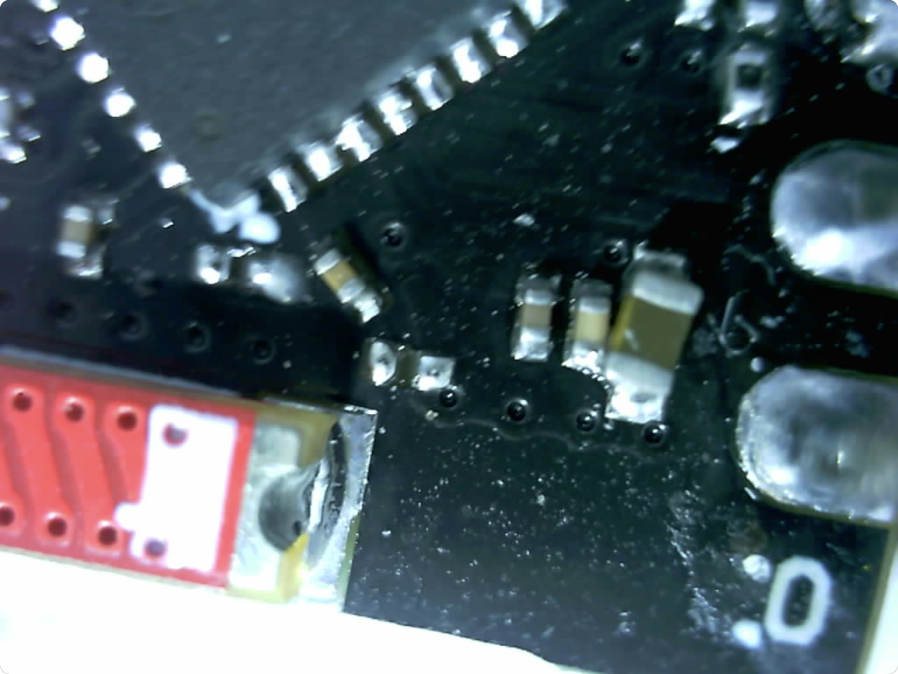
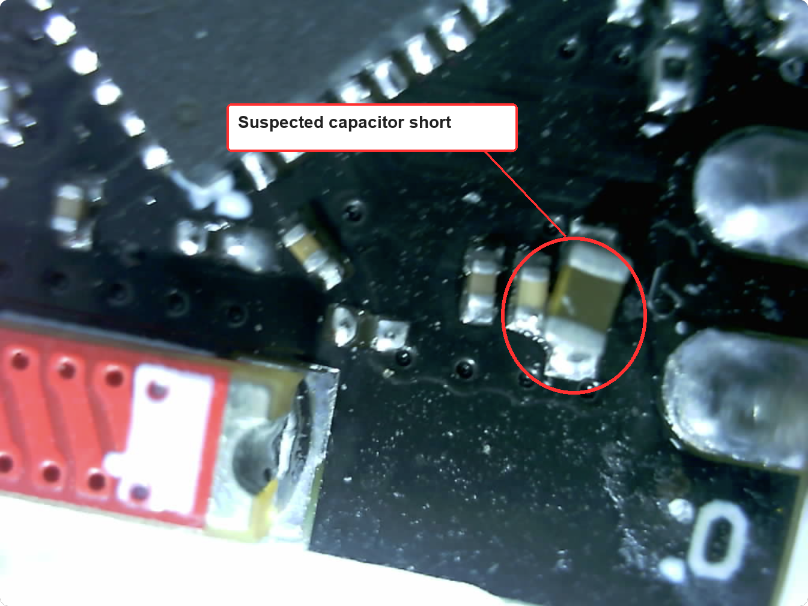

# PCB inspection example

| Original | Marked finding |
|---|---|
|  |  |

Operator-reported short at the right-side capacitor cluster. Verify with power removed and resistance/continuity measurements; the photo alone does not establish an electrical short. Original screenshot cropped to the camera image and exported without metadata. The annotated copy adds only a circle and label.

## Inspection record
Associate each original photograph and its separate annotation with part, lot, serial, operator, timestamp, finding and disposition. Preserve original pixels for review.
