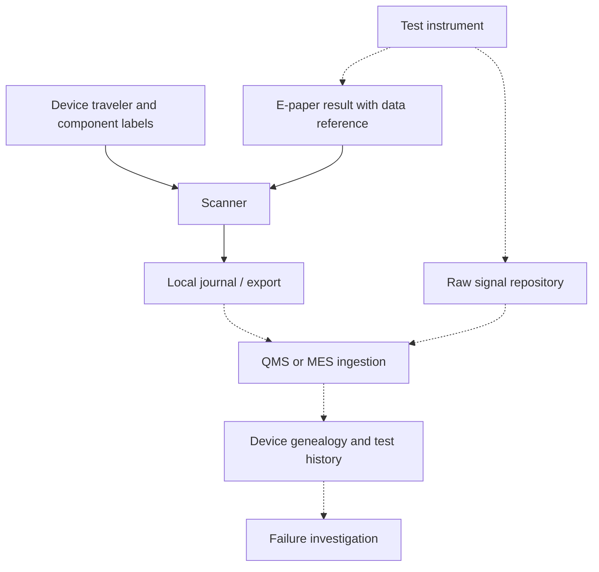

# Traceability and proposed QMS integration

## Current prototype

The scanner records a journal event for each accepted or rejected workflow label, start, completion, cancellation or timeout. The record contains the recipe, revision, run ID, step, raw payload, device and equipment identifiers, reported disposition, result ID, data reference, failure reason, operator context, timestamp and uptime. Component lot and serial, accessory IDs and measurement fields appear in the raw payload. Exposure duration is recorded in the aging event message.

The station exports workflow records as JSON. The underlying journal is newline-delimited JSON; it is bounded local storage, not an authenticated audit ledger.

The workflow page now presents the current run as a structured traceability record and exports it through the local `/workflow-record` endpoint. It includes the run and recipe IDs, scanner MAC, device and equipment, operator session, result fields, scanned label payloads, synchronized timestamps when available, and device uptime for offline timing. The summary is built from the current in-memory workflow; after a reboot, the local NDJSON journal retains individual events, but the UI does not yet reconstruct prior run summaries.

## Proposed production data flow

The scanner accepts a result label today; the physical e-paper display and automated raw-data repository links are proposed. External ingestion would join the data reference to a unique bench run, preserve the original measurements and associate them with the device serial. It should verify identifiers, enforce uniqueness, retain source files and reconcile failed/partial runs before releasing a unit.

Potential investigations include component lot containment, repeated equipment-associated failures, missing required tests and hardware revision effects. The four PDF examples have **different device serials**; they do not represent one device traveling through all four procedures.

## Example event files

The individual workflow pages include synthetic journal arrays generated from the actual shared PDF payloads and current firmware event fields. They demonstrate structure, not actual measured production results. Timestamps and operator values are synthetic. The dashboard export additionally wraps records with operator, device MAC and active state.

[Workflow examples](../workflows/README.md)

## Production requirements

Authenticated operator identities, controlled recipes and revision approval, inventory and equipment lookup, instrument-calculated disposition, durable unique identifiers, reliable clock synchronization, recoverable runs, protected audit trail, secure transport and validated data retention. The current prototype does not establish regulatory compliance.

## Failure investigation applications

A device serial connects component genealogy and test history. The scanner records the equipment identifier, measurement disposition and data reference, alongside operator and time information. In a production integration, the bench would upload raw measurements to a data repository and display a result code with the matching reference. The QMS or MES could join both records to investigate recurring failures by component lot, equipment or hardware revision.
