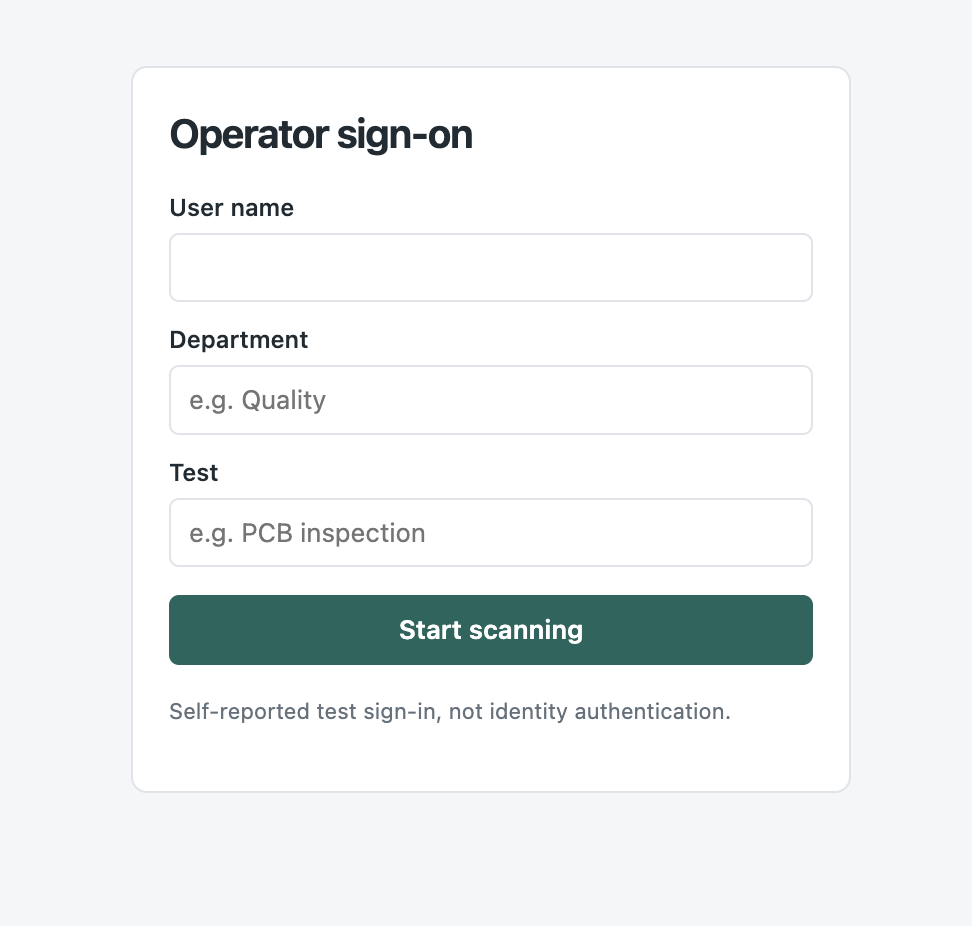
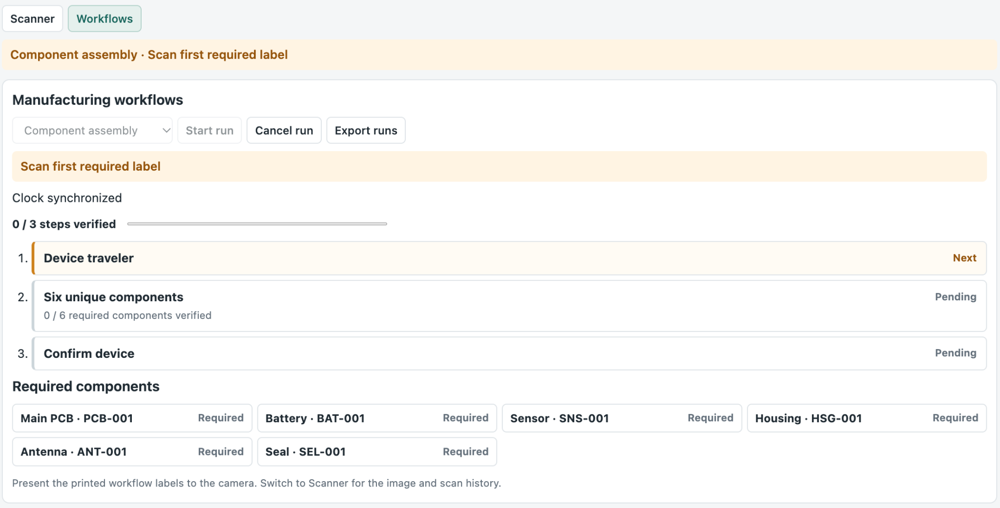
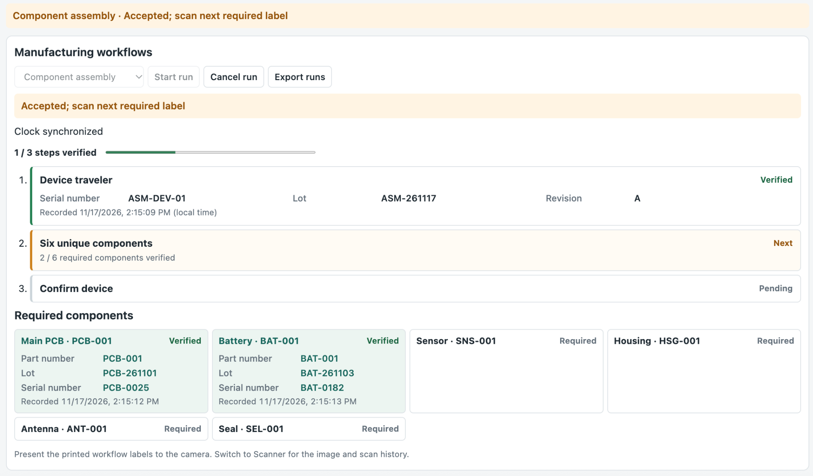
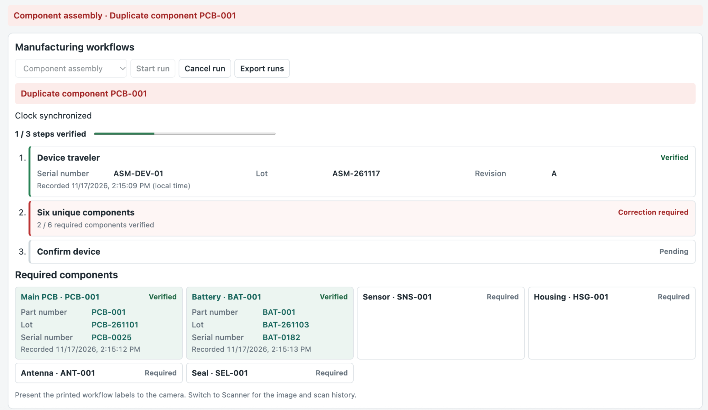
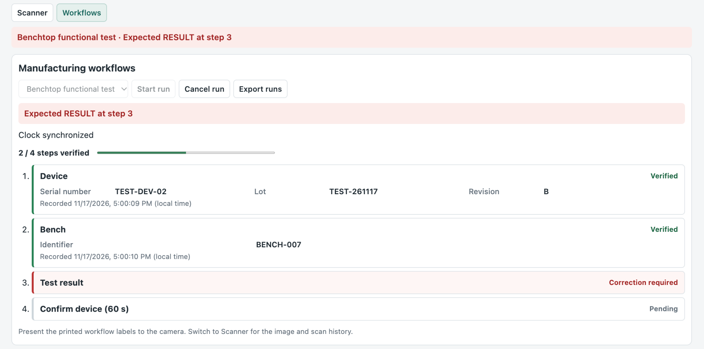
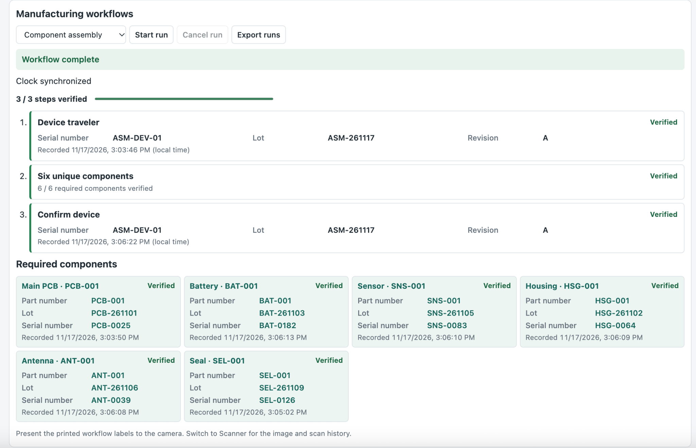

# Operator experience

The browser dashboard has two views: **Scanner** for camera preview, decoded records and inspection capture; **Workflows** for procedure progress and verification. In Embedded mode, the operator can follow the instruction sheet without keeping the browser open.

## 1. Operator sign-on

Enter the operator, department and test context from a computer or mobile browser.

## 2. Start the procedure

Scan the four-digit Code 128 header from the [shared instruction sheet](../workflows/instructions.pdf). The station selects the recipe and displays the required steps.

## 3. Verify components

Present each required label. The station captures part numbers, lots, serials and timestamps; accepted components are marked verified. Embedded mode requires no browser interaction between scans.

## 4. Correct errors

A repeated component, unexpected label or wrong step triggers a warning. The verified component count remains unchanged until the correct label is accepted.

During benchtop testing, the station prompts the operator to scan the expected result label before proceeding.

## 5. Complete and export

Rescan the original device after all requirements are satisfied. The dashboard shows the completed procedure and the operator can export the journal. See the [assembly demonstration](../workflows/01-component-assembly/README.md) for the recorded example.

[Audible feedback and configuration](../settings/README.md#audible-feedback-and-operator-usability) · [Operating instructions](../OPERATIONS.md)
