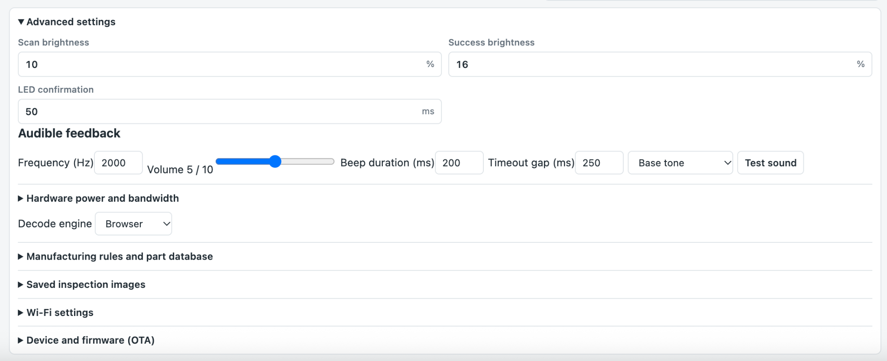
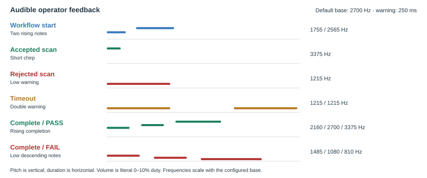

# Scanner configuration



These are initial tuning values for the prototype, not qualified production settings. Open the device's local browser interface and expand Advanced settings.

| Control | Suggested starting point | Purpose and adjustment |
| --- | --- | --- |
| Resolution | 640 × 480 | Increase for fine marks if needed; higher resolution increases transfer and decode cost. |
| Scan rate | Start low, then increase | Requested rate is a ceiling, not achieved frame rate. |
| Scan brightness | 10% | Increase until dark modules separate clearly; reduce glare and heating. |
| Success brightness | 16% | Confirmation flash should remain visible over the scan illumination. |
| LED confirmation | 50 ms | Increase if the flash is difficult to see. |
| Frequency | 2000 Hz | Base pitch for the passive buzzer; tune using Test sound. |
| Volume | 5/10 | Literal 5% PWM duty; zero mutes, ten is 10%. Loudness is transducer-dependent. |
| Beep duration | 200 ms | Warning and base test tone duration. |
| Timeout gap | 250 ms | Silence between timeout beeps. |
| Sound preview | Individual pattern | Select and test start, accepted, rejected, timeout, PASS or FAIL. |



The plot uses the firmware default base pitch, not the suggested 2000 Hz tuning example. Frequencies scale with the configured base.

## Power, bandwidth and decoding

| Control | Meaning |
| --- | --- |
| CPU | 80, 160 or 240 MHz; use 240 for initial performance tests, reduce only after benchmarking. |
| Wi-Fi power saving | Reduces radio activity; compare latency with it off if preview stalls. |
| JPEG compression | 8–30; lower is higher quality. Start around 10, compare detail and bandwidth. |
| Auto standby | Stops camera activity when idle under applicable mode conditions. Wake before scanning. |
| Decode engine | Browser for live preview and inspection; Embedded for standalone scanning after sign-on. |

Avoid unattended continuous operation until temperatures and power have been characterized.

## Manufacturing rules and part database

Custom JSON parsing rules define prefix, separator and fields; the local part dictionary maps identifiers to descriptions. Save local settings applies browser-local configuration, not a controlled firmware recipe or production inventory service.

Example rule:

```json
[{"prefix":"PCB:","separator":"/","fields":["part","lot"]}]
```

Example dictionary:

```json
{"PCB-DEMO-001":"Example control PCB"}
```

## Wi-Fi and timestamps

Expand Wi-Fi settings, enter the network name and password, and select Save. Reconnect using the scanner's assigned local IP address; use the USB serial console or router's client list to locate it if needed. Use a trusted LAN. NTP synchronizes timestamps when network access is available; verify Clock synchronized on the workflow screen. Without a synchronized clock, use uptime and boot context for relative ordering.

## Firmware updates (OTA)

Expand Device and firmware (OTA) to inspect device information. The interface displays the command for the local upload utility; it does not provide a browser firmware-upload form.

1. Export records, finish active runs and ensure stable power.
2. Build with `pio run`.
3. Retrieve the device-specific credential using the USB serial command `OTAKEY`. Never publish it.
4. Run `python3 tools/ota_upload.py <scanner-ip>` and follow the utility's credential prompt.
5. Verify reboot, camera, scanner and workflow behavior before relying on the new firmware.

The initial dual-slot installation requires USB. See [operating instructions](../OPERATIONS.md) for rollback design and limitations. Never expose the HTTP interface or OTA service to the public internet.

## Inspection images

Use [macro capture and annotation](../inspection/README.md) to create supporting visual evidence. Export saved images before clearing browser storage.
