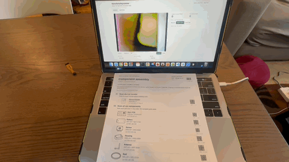
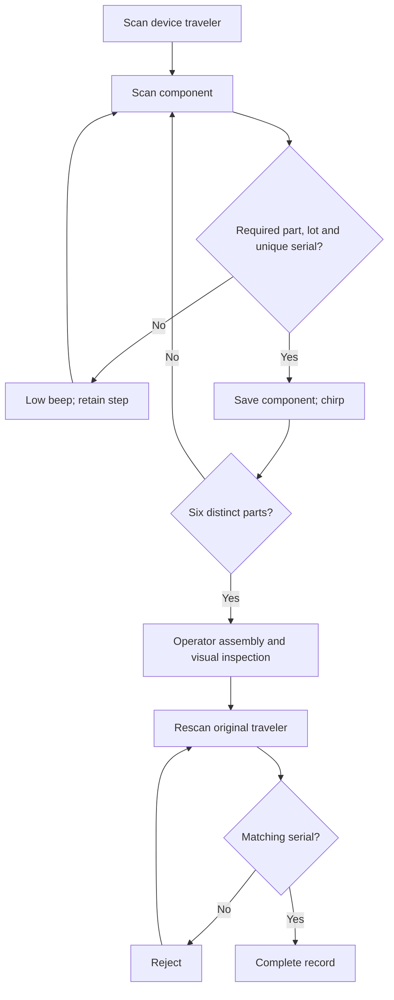
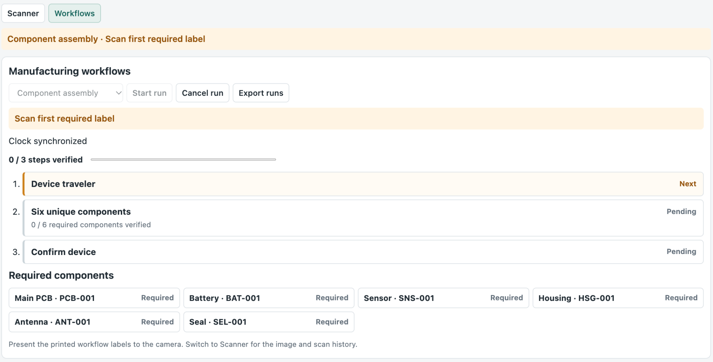
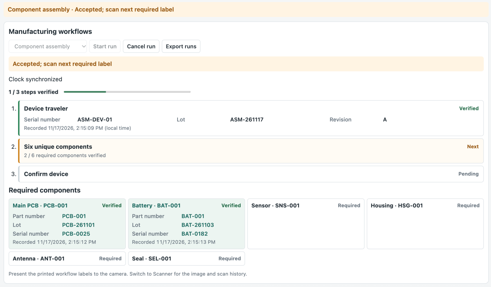
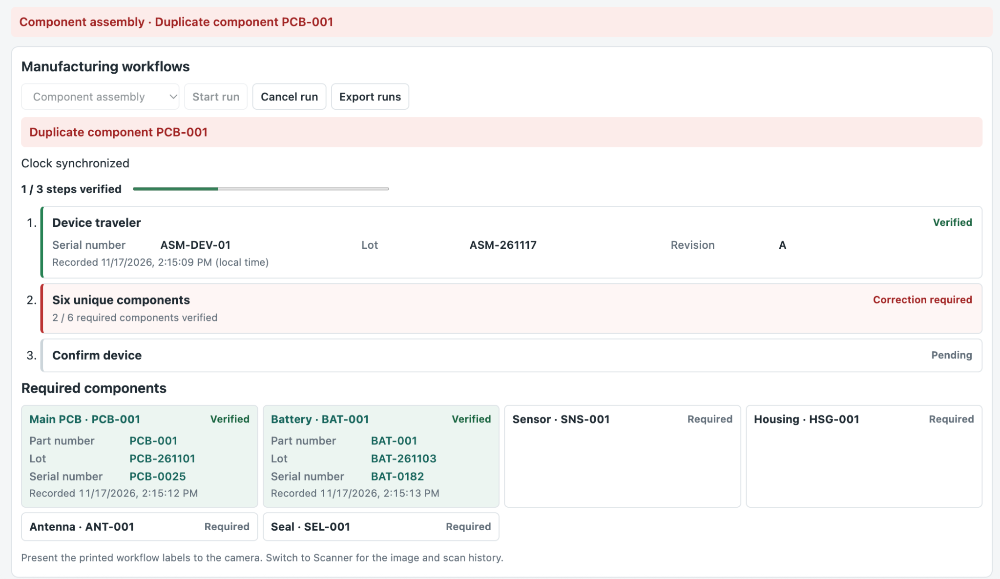
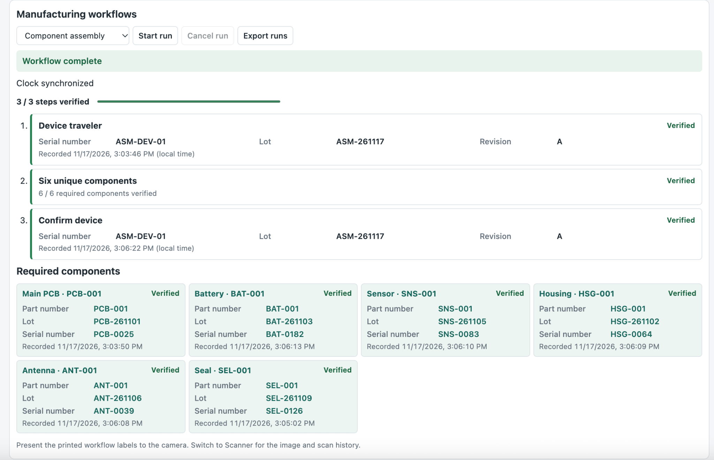

# 01 — Component assembly

**ASM-01 | Start code 0101 | [Shared instructions, page 1](../instructions.pdf#page=1)**

## Objective

Build a device genealogy without manually copying each component's part number, lot and serial. Detect unexpected or repeated components before closing the traveler.

[Full demonstration with actual buzzer sound](../../media/assembly-audible.mp4) (47 seconds; printed sample labels).

## Procedure

| Step | Operator action | Reason |
| --- | --- | --- |
| 1 | Scan the device traveler | Establish the unit's identity |
| 2 | Scan each required component once, in any order | Record its part, lot and serial |
| 3 | Assemble and visually inspect the device, then rescan the original traveler | Record operator confirmation after all required labels |

| Component | Required part number |
| --- | --- |
| PCB | PCB-001 |
| Battery | BAT-001 |
| Sensor | SNS-001 |
| Housing | HSG-001 |
| Antenna | ANT-001 |
| Seal | SEL-001 |

## Acceptance and error handling

The firmware requires six distinct specified part numbers, nonempty component lot and serial, and the original device serial at closure. A repeated part number or serial, wrong recipe or early final confirmation is rejected without advancing. Holding an unchanged code continuously in view is suppressed by scan deduplication; remove and present it again to trigger duplicate validation.

[Example event journal](example-record.json) — synthetic replay using the shared PDF labels.

The scan sequence is evidence of label verification, not independent proof that the scanned parts were installed or visually inspected. Lot and serial values are supplied by labels, not authenticated against a production inventory database.

## Actual dashboard examples

