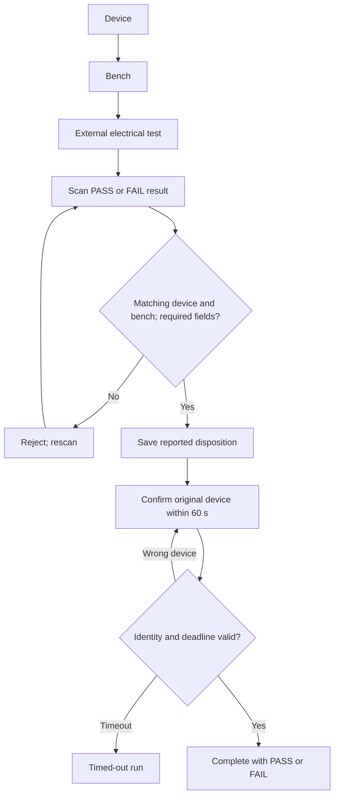
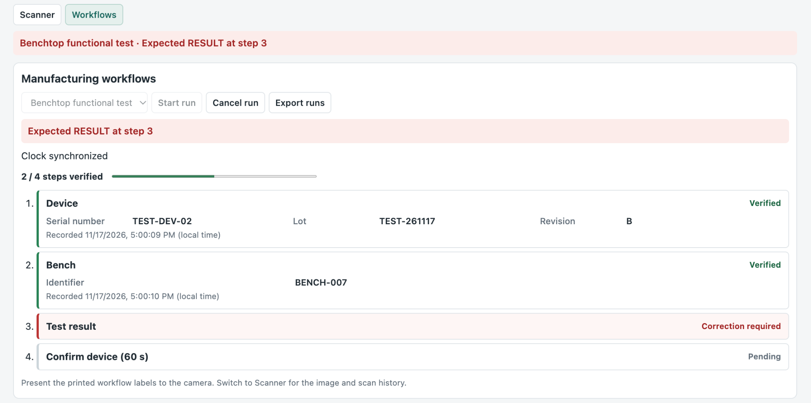

# 02 — Benchtop functional test

**TEST-01 | Start code 0201 | [Shared instructions, page 2](../instructions.pdf#page=2)**

## Objective

Associate a known device with a test station, measurement disposition and reference to the original measurement data. Avoid transcription of results or accidental association with another device.

| Step | Operator action | Reason |
| --- | --- | --- |
| 1 | Scan device TEST-DEV-02 | Identify the unit under test |
| 2 | Scan BENCH-007 | Associate the test station |
| 3 | Run the electrical test and scan one result code | Record measurement values and data reference |
| 4 | Rescan original device within 60 seconds | Confirm the tested unit |

## Illustrative electrical criteria

Apply 5 V in the example; the actual bench produces measurements.

| Measurement | Example limit | PASS | FAIL |
| --- | --- | --- | --- |
| Output voltage | 4.75–5.25 V | 5.02 V | 4.51 V |
| Supply current | ≤100 mA | 62 mA | 62 mA |
| Result reference | Unique bench run | RUN-0262P | RUN-0262F |
| Failure reason | Required on FAIL | NONE | OUTPUT_LOW |

The result display in the PDF simulates an electronic-paper display. Scan either alternative, not both. A valid FAIL is recorded and can be closed normally. Incorrect device or bench, missing measurement fields, missing failure reason, incorrect step and expired confirmation are rejected.

[PASS example journal](example-pass.json) · [FAIL example journal](example-fail.json) · [Proposed bench and QMS integration](../../integration/README.md)

The scanner captures the result label, including measurement values and the bench-reported disposition. Instrument control, limit evaluation and raw-data ingestion belong to the proposed bench integration.

## Actual dashboard examples

