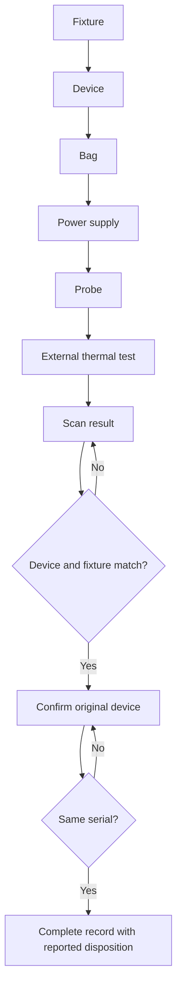

# 03 — Thermal fixture test

**THERM-01 | Start code 0301 | [Shared instructions, page 3](../instructions.pdf#page=3)**

## Objective

Capture the complete fixture setup and correct device association before accepting a thermal test result. This supports investigation of failures linked to fixtures or accessories.

| Step | Operator action | Reason |
| --- | --- | --- |
| 1 | Scan fixture THERM-009 | Identify test station |
| 2 | Scan device THERM-DEV-03 | Identify tested unit |
| 3 | Scan bag BAG-016 | Record test accessory |
| 4 | Scan supply PSU-042 | Associate power equipment |
| 5 | Scan probe TC-023 | Identify measurement probe |
| 6 | Run test and scan PASS or FAIL result | Associate temperature and data reference |
| 7 | Rescan original device | Confirm record closure |

At every scanned step, a wrong recipe, label type or encoded step triggers rejection without advancement.

## Illustrative thermal criteria

| | PASS | FAIL |
| --- | --- | --- |
| Example temperature limit | 35–37 °C | 35–37 °C |
| Reported measurement | 36.2 °C | 38.4 °C |
| Result / data reference | RUN-0263P | RUN-0263F |
| Failure reason | NONE | TEMP_HIGH |

Both reported outcomes may be accepted and closed. No final confirmation deadline is imposed in this recipe.

[PASS example journal](example-pass.json) · [FAIL example journal](example-fail.json)

The workflow checks accessory types and identifiers and records the reported temperature result. Physical setup, calibration and compatibility checks remain operator and test-system responsibilities.
