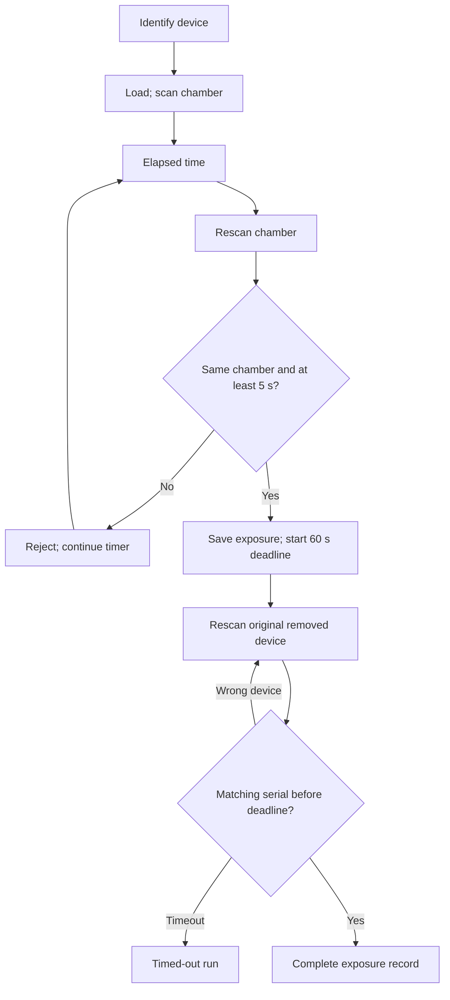

# 04 — Environmental aging

**AGE-01 | Start code 0401 | [Shared instructions, page 4](../instructions.pdf#page=4)**

## Objective

Associate a device with an environmental chamber and record elapsed exposure without manually recording start and stop times.

| Step | Operator action | Reason |
| --- | --- | --- |
| 1 | Scan device AGE-DEV-04 | Establish identity |
| 2 | Load device and scan AGE-008 | Start monotonic timer |
| 3 | Wait at least five seconds; rescan same chamber | Stop timer and record exposure |
| 4 | Remove device and rescan within 60 seconds | Confirm original unit |

The monotonic timer measures time between chamber scans, independently of network clock synchronization. The five-second minimum is for a demonstration, not an environmental qualification specification. Chamber scans represent operator actions rather than sensed door events. The prototype supports one device per active run, does not log actual chamber temperature or humidity and cannot restore an interrupted active run after reboot.

[Example event journal](example-record.json)

No dedicated recording for this workflow is published yet.
