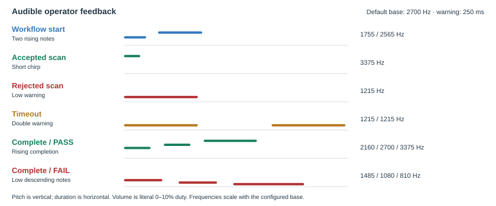

# Manufacturing and test workflows

[Shared operator instructions and scannable labels (PDF)](instructions.pdf) — four pages, print at 100% scale. The instruction revision and encoded recipe revision are separate.

| Header | Procedure | Example |
| --- | --- | --- |
| 0101 | ASM-01 | [Component assembly](01-component-assembly/README.md) |
| 0201 | TEST-01 | [Benchtop functional test](02-benchtop-functional-test/README.md) |
| 0301 | THERM-01 | [Thermal fixture test](03-thermal-fixture-test/README.md) |
| 0401 | AGE-01 | [Environmental aging](04-environmental-aging/README.md) |

Sign on, select Embedded mode and resume scanning. Scan the header, then present one label at a time; remove each from view before rescanning. Recipe revision 01 is encoded in the last two header digits. Labels contain WF, STEP, TYPE and SN or ID; result labels also contain DEVICE, BENCH, DATA, STATUS, measurement values and REASON.

A successful scan means the record was accepted, not that the physical test passed. PASS and FAIL dispositions both require final device confirmation. The operator performs the actual assembly, inspection and test; the scanner verifies scanned information. The shared PDF currently retains the earlier vibration legend until its vector-preserving revision is completed.

The six successful host regression paths replay the PDF labels, including both alternative measurement dispositions. Additional tests reject wrong steps, duplicate parts, identity mismatches and storage failures, and exercise exposure timing and timeouts. Physical read reliability is not implied by software tests.

[Operating instructions](../OPERATIONS.md) · [Example journal records and integration](../integration/README.md)
