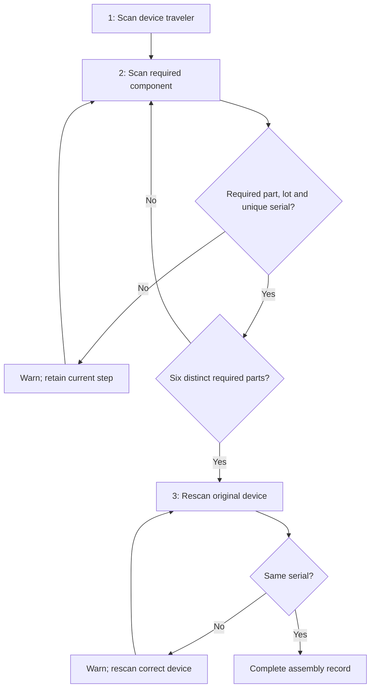
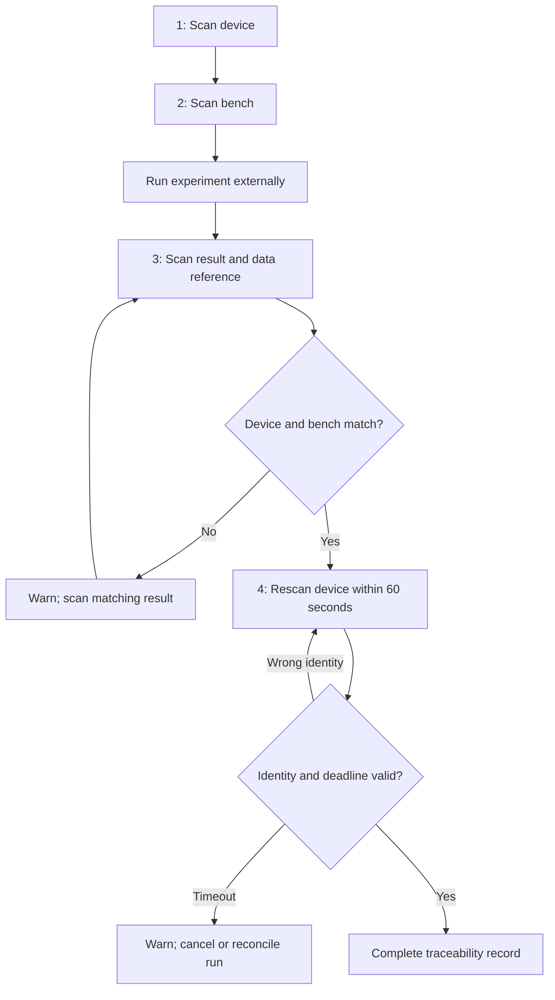
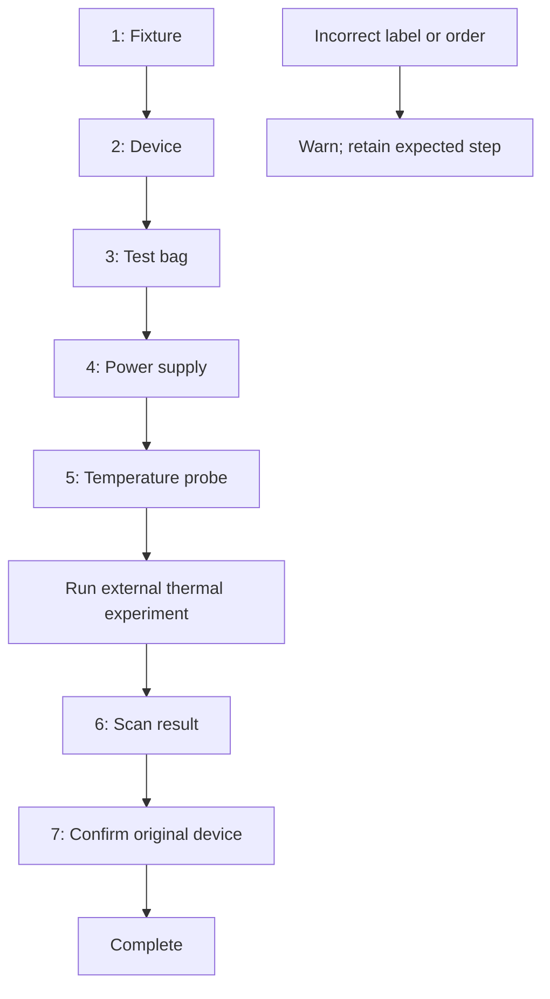
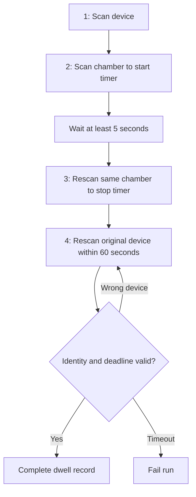

# Manufacturing workflow examples

[Operator instructions and scannable labels (PDF)](../test-sheets/manufacturing-pipeline.pdf) — print at 100% scale.

Sign on first. Scan the Code 128 header or start the corresponding recipe from Workflows. Present one label at a time; remove it between rescans. Recipe revision 01 is encoded in the final two digits of each header.

| Header | Recipe |
|---|---|
| 0101 | ASM-01 |
| 0201 | TEST-01 |
| 0301 | THERM-01 |
| 0401 | AGE-01 |

Labels contain `WF`, `STEP`, `TYPE`, and `SN` or `ID`. Result labels also contain `DEVICE`, `BENCH`, `DATA`, `STATUS`, measurement values and `REASON`. The instrument's PASS/FAIL disposition is recorded, not inferred from a successful scan. The example measurement limits are illustrative.

The approved PDF footer predates implementation of scan-to-start, result disposition and feedback patterns. These features are now included in the firmware. Physical scan and haptic performance still require bench verification.

## ASM-01 — component assembly

Required part IDs: PCB-001, BAT-001, SNS-001, HSG-001, ANT-001, SEL-001. Scan them in any order within step 2. An early device confirmation or duplicate part is rejected.

## TEST-01 — benchtop functional test

Scan either the PASS or FAIL e-paper result, not both. The result label links the equipment, device, run ID, voltage, current and failure reason. Confirm the device within 60 seconds even when the measurement failed. The scanner does not execute the experiment, fetch cloud data or validate measurement accuracy.

## THERM-01 — fixture-mounted thermal testing

Scan the fixture and each accessory in order, then scan a matching PASS or FAIL temperature result. Confirm the original device regardless of outcome. Physical fixture interlocks and automatic instrument control are not implemented.

## AGE-01 — environmental aging

One device per active run. Exposure is measured between the two chamber scans. A five-second minimum is for demonstration only. Monotonic timing is independent of NTP synchronization. A reboot loses active workflow state but leaves persisted journal events. Chamber scans represent operator actions, not a physical door sensor.

## Validation status

Host regression tests replay the actual PDF payloads for all six valid paths (including both measurement outcomes), step skipping, duplicate parts, mismatched identity, timeout, elapsed exposure and storage failure. Physical scanning, motor response, power interruption recovery and production reliability require hardware qualification.
