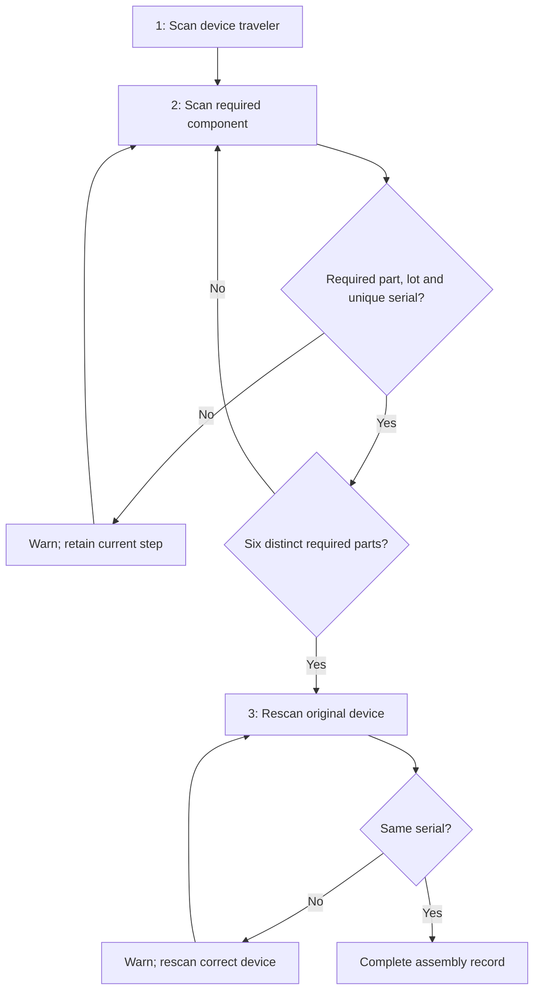
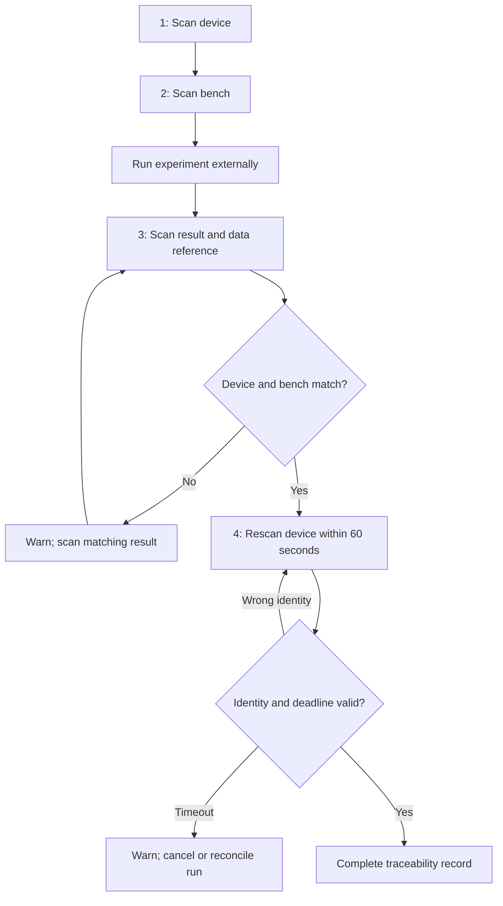
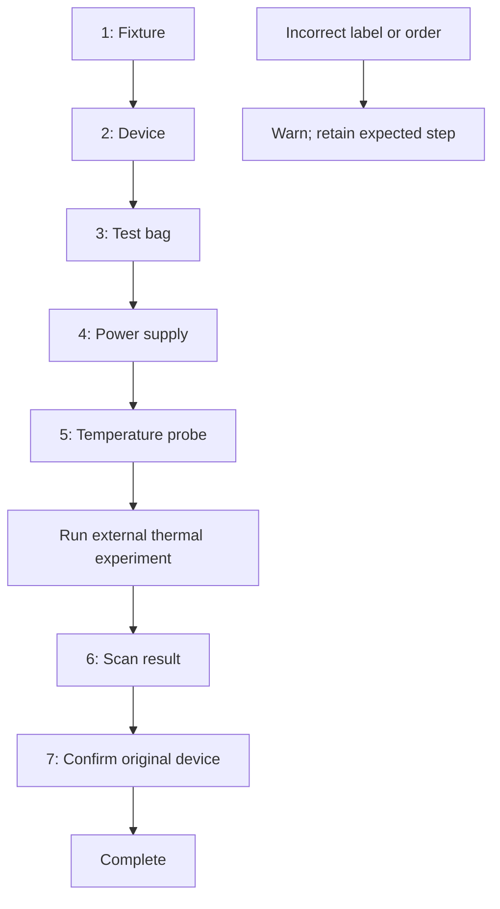
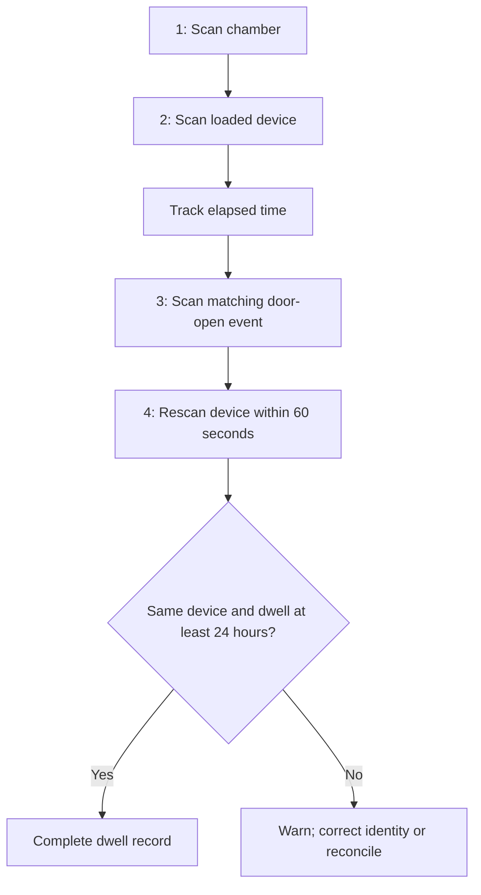

# Workflow verification examples

The ESP32 checks label sequence and identity in both decoder modes. Select **Workflows**, start a run, and scan the labels. Rejected scans retain the current step and trigger a warning. Cancel an expired run before restarting. The device records accepted and rejected events in its local journal; export runs as JSON before clearing records.

[Print the four-page mixed-format test PDF](../test-sheets/manufacturing-pipeline.pdf) at 100% scale. Linear codes are capability checks only.

All examples use semicolon-separated fields: `WF` (recipe ID), `STEP` (label entry step, starting at 1), `TYPE`, and `SN` or `ID`. The same device label is reused at final confirmation. Use the printable labels externally; the dashboard displays process progress rather than QR examples.

## ASM-01 — component assembly

[Printable QR labels](ASM-01.html)

Required part IDs: PCB-001, BAT-001, SNS-001, HSG-001, ANT-001, SEL-001. Scan them in any order within step 2. An early device confirmation or duplicate part is rejected.

## TEST-01 — benchtop functional test

[Printable QR labels](TEST-01.html)

The result label links the equipment, device and run ID. The scanner does not execute the experiment, fetch cloud data or validate measurement accuracy.

## THERM-01 — fixture-mounted thermal testing

[Printable QR labels](THERM-01.html)

Scan the fixture and each accessory in order before presenting a matching result. Physical fixture interlocks and automatic instrument control are not implemented.

## AGE-01 — environmental aging

[Printable QR labels](AGE-01.html)

One device per active run. The 24-hour minimum is an example, not a validated product requirement. Timing uses the ESP32 monotonic clock; uninterrupted power is required. A reboot loses active workflow state but leaves persisted journal events. Door opening is manually represented by a label, not a sensor.

## Validation status

Host regression tests cover all four workflows, step skipping, duplicate parts, mismatched identity, timeout, premature removal and storage failure. Physical scanning, motor response, power interruption recovery and production reliability require hardware qualification.
